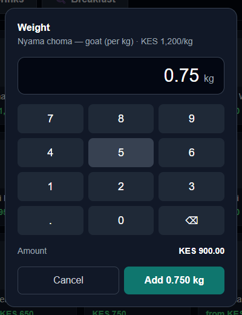
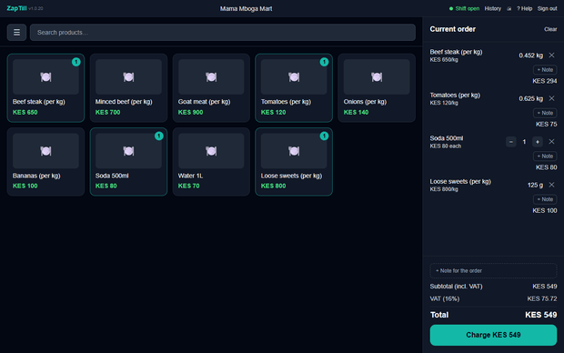
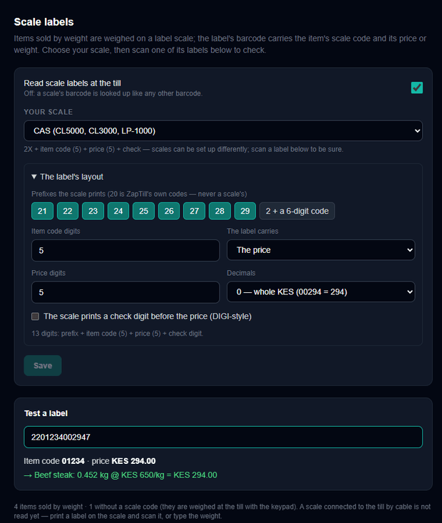
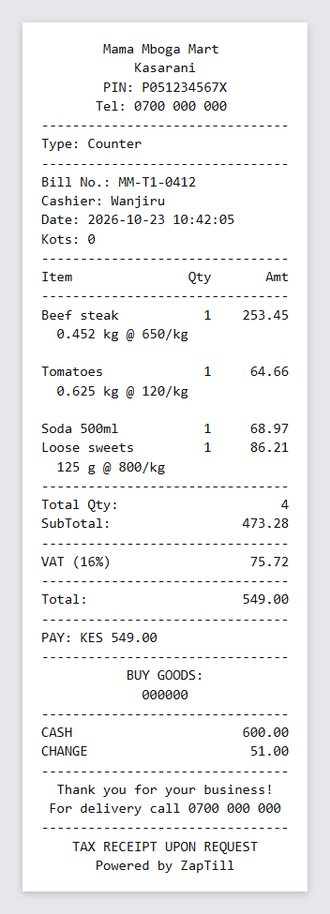
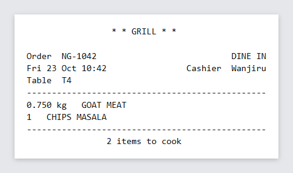

# Items sold by weight

Some things are sold by the kilo: meat, fish, fruit and vegetables, loose sugar or sweets, nyama choma. ZapTill sells them with the **weight as the quantity** (0.452 kg) and works out the amount from the price per kg. This manual covers:

- marking an item as sold by weight;
- weighing at the POS with the weight keypad (every kind of business);
- weighing on a **label scale** and scanning its label at the POS;
- choosing your scale and testing a label;
- what the receipt and the kitchen ticket show.

> The amount is always **price per kg × weight**, rounded to the cent — 0.452 kg at KES 650/kg is KES 293.80. When a scale prints the **price** on its label, the label's price is what the customer pays.

## 1. Mark an item as sold by weight

1. On the web, open **Menu › Products** and **Edit** the item (or add a new one).
2. Set **Price** to the price **per kg**.
3. Switch on **⚖️ Sold by weight (price per kg)**.
4. **Show the weight in**: *Kilograms* (0.452 kg) or *Grams* (452 g). The price stays per kg either way.
5. **Scale code (PLU)**: the number the item has on your weighing scale (for example 1234). Leave it empty if you do not use a label scale.
6. Click **Save**. The points of sale pick it up at their next sync.

> Each scale code can belong to one item only. 01234 and 1234 are the same code.

## 2. Weighing at the POS (any business)

Tap an item sold by weight on the desktop POS (or on the web POS). ZapTill asks for the weight:



1. Read the weight on your scale and type it in **kg**: 0.75 for 750 g, 1.2 for 1.2 kg. Up to three decimals (the gram).
2. The amount is shown as you type.
3. Click **Add**. The item goes on the order as its own line with its weight.

A weighed line has no + / − buttons: to change it, remove it (✕) and weigh it again. Two bags of the same item are two lines.

This works in every kind of business:

- **Shops, minimarts, butcheries** — loose goods on the grid.
- **Restaurants and cafés** — nyama choma or fish by the kilo. The kitchen ticket shows the weight: `0.750 kg   GOAT MEAT`.
- **Petrol stations** — items from the shop. Fuel is still sold from the pumps in litres, exactly as before.
- **Parking and other businesses** — the same as a shop, for any goods you sell.

## 3. Label scales: scan the label

A label scale weighs the item and prints a sticker with a barcode. The barcode carries the item's **scale code** and either the **price** or the **weight**. At the POS, just scan the sticker: the item is added with its weight and the right amount — no typing.



Scanning works on the POS in shops, minimarts, parking and "other" businesses, and on a petrol station's shop screen (not on the pump screen). A restaurant POS taps items instead of scanning.

> Scale barcodes start with **21 to 29**. Barcodes that start with **20** are ZapTill's own codes for your products (from **Generate barcodes**) and are never read as scale labels.

If the POS says **"No item has the scale code …"**, the scale code on the label is not set on any item: open the item on the web and type the code in **Scale code (PLU)**.

## 4. Choose your scale and test a label

On the web, open **Settings › Business › Scale labels**.



1. **Your scale** — pick the one you have:

| Choice | What the label carries |
|---|---|
| Standard — price on the label | 2X + item code (5) + price (5) + check digit |
| Standard — weight on the label | 2X + item code (5) + weight in grams (5) + check digit |
| CAS (CL5000, CL3000, LP-1000) | 2X + item code (5) + price (5) + check digit |
| DIGI (SM-100, SM-120, SM-5300) | 2X + item code (5) + price check digit + price (4) + check digit |
| Ishida (Uni-3, Uni-5, BC-4000) | 2X + item code (5) + weight in grams (5) + check digit |
| Six-digit item code — price | 2 + item code (6) + price (5) + check digit |

2. Scales can be set up differently in their own menus. Open **The label's layout** to set the prefixes your scale prints (21–29), the item code length, price or weight, the number of digits and decimals (a price in whole shillings or in cents; a weight in grams or tens of grams), and whether the scale prints a price check digit.
3. Print one label on your scale and scan it into **Test a label**. ZapTill shows the item code, the price or weight, the item it found and the amount. When that is right, click **Save**.

> Who can change it: anyone with **Business settings**. The points of sale read the new layout at their next sync and keep it for when they are offline.

## 5. Receipts and kitchen tickets

A weighed item prints as **one item** with its weight and price per kg under it, so **Total Qty** counts it once:



```
Beef steak           1    253.45
  0.452 kg @ 650/kg
Loose sweets         1     86.21
  125 g @ 800/kg
```

The kitchen ticket puts the weight before the dish:



Stock is taken off to the gram (10 kg − 0.452 kg = 9.548 kg), and a refund puts the same weight back.

## 6. Good to know

- A scale connected to the POS by a cable is **not read yet**. Print a label on the scale and scan it, or type the weight on the keypad.
- Offers such as "buy 2 get 1" count whole items, so they do not apply to weighed lines.
- The POS's own Menu screen does not change "Sold by weight" or the scale code yet — set them on the web.
- After this update, ask your technician to run **migration 167** (weights kept to the gram) and install the new POS (it needs the new POS version to show the weight keypad).
