# ZapTill Technician Setup Guide

*Version 1.6 · 23 October 2026 · ZapTill 1.0.20 · for ZapTill field technicians*

This guide takes a ZapTill technician from an empty account to a client selling on a working till, then to the technician access used for support afterwards. Follow the steps in order; each one depends on the one before.

**New in 1.0.20:** the installer is downloaded from the admin portal (Step 7a); the first desktop licence starts a one-month cloud trial, so the licence now comes before web access (Step 2); the owner must change the temporary password at the first sign-in (Step 3); a customer gets a credit limit from **+ Give credit**, and only the owner or a manager sets credit limits; the owner may choose who approves sales on account, branch by branch, and a customer's profile shows their **Credit history** (Step 6); the business type now decides the wording, such as Menus or Departments (Step 1); the cloud is now a payment plan per business (month on month by default, KES 3,000 a month) with **Record payment**; an invoice is emailed on the first day of each period and a client unpaid 7 days after it is locked at once (the web dashboard paused, the tills keep selling but stop syncing); the old KES 10,000 **Enable web access** is gone (Step 2b); a partner of some branches sees only theirs, with **All my branches** to add them up (Step 5); plus the zero-stock setting, menus as tabs on the till, other branches' stock, barcodes and labels, and the approval PIN as a feature switch.

## Before you go

Collect these from the client before the visit. Most setup delays come from a missing item on this list.

| What | Why you need it | Example |
| --- | --- | --- |
| Business name and type | Creates the account, picks the right features and sets the words the screens use (restaurant, retail, petrol station) | Mama Lishe Grill, restaurant |
| Owner's full name, email and phone | The owner's sign-in to the web dashboard; the email must be one they can open on the day | Jane Wanjiru, jane@example.com |
| Branches | One per physical shop; each gets its own tills, printers and stock | Ngong Road, Westlands |
| M-Pesa Buy Goods or Paybill number (and account) | Printed large on every receipt | Buy Goods 777111 |
| The menu in Excel | Loaded in one upload instead of typing every item | The ZapTill menu template |
| Logo (PNG) and receipt footer text | Branding on the till and the receipt | Address, phone, socials |
| Staff list with roles | Each person gets a PIN and a role | 2 cashiers, 1 supervisor, 1 manager |

Bring or confirm on site:

- [ ] A Windows 10 or 11 PC (64-bit) for each till; one of them becomes the branch server when there is more than one till
- [ ] An 80 mm or 58 mm thermal receipt printer (USB or network), and a kitchen printer if the kitchen will print
- [ ] A cash drawer connected to the receipt printer, if used
- [ ] Internet for the setup day (the tills keep selling offline afterwards)
- [ ] A small UPS for the till PC: the till needs power to keep selling during a power cut
- [ ] Your ZapTill admin portal sign-in, and the ZapTill installer (download it from the admin portal before you leave: Step 7a)

The three places you will work in:

| Site | Address | Who uses it |
| --- | --- | --- |
| Admin portal | admin.zaptill.co.ke | ZapTill staff only: creates clients, switches features |
| Web dashboard | app.zaptill.co.ke (or the client's own address) | The owner, managers, partners |
| Till | The ZapTill app on the Windows PC | Cashiers, waiters, managers |

## Step 1 — Create the client in the admin portal

One form creates the business, its first branch, the owner's sign-in and every built-in role. Licences and features come in Step 2.

1. Sign in at **admin.zaptill.co.ke** with your email and password, then enter the 6-digit sign-in code (emailed, or from your authenticator app). Tick **Remember this browser for 30 days** on your own laptop only.
2. In the sidebar, under **Clients**, click **New client**.
3. **Business Type**: click the right tile — Restaurant, Café, Retail, Minimart, Parking, Petrol Station or Other. The default is **Minimart**, so always click the tile. The type decides the words and the screens the client sees (table below), so get it right now.
4. **Business Details**: **Business Name** (required), **Phone**, **Currency** (default KES) and **VAT Rate (%)** (default 16).
5. **Main Branch**: **Branch Name** (required) and **Address**.
6. **Owner Login Account**: **Owner Name**, **Email** (required) and **Temporary Password** (at least 8 characters). The password field shows what you type, so type it with the owner beside you.
7. Click **Create Restaurant** (the button names the type). Wait for **Client created!**

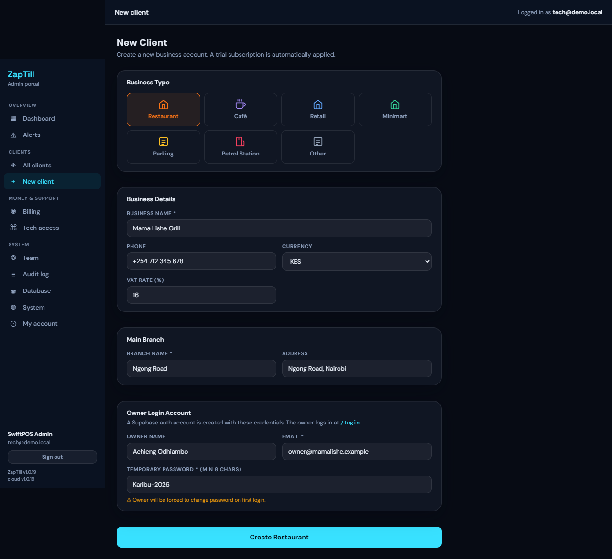

The success panel shows the Business ID, branch, owner login and temporary password. Write the temporary password down for the owner, then click **View client →**.

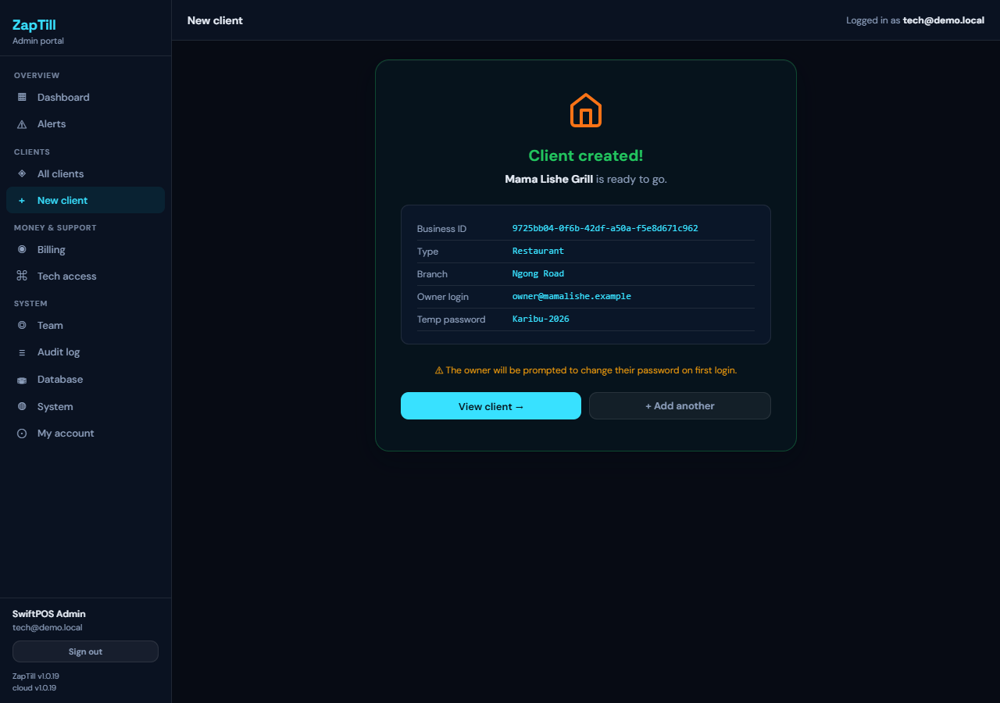

**Why the business type matters.** The same features carry different names, and kitchen features show only where there is a kitchen:

| Type | Groups of categories | Kitchen features |
| --- | --- | --- |
| Restaurant, Café | **Menus** (Food, Soft drinks) | Shown |
| Retail, Minimart, Petrol Station | **Departments** (Groceries, Household) | Hidden |
| Parking, Other | **Groups** (Parking, Car wash) | Hidden |

Kitchen features are the kitchen display, combo meals, ingredients, tables and the kitchen switches. A restaurant's web sidebar says **Menu** and **Inventory**; a shop's says **Catalogue** and **Stock**.

A shop created as a restaurant sees "Menus", tables and the kitchen display; a restaurant created as a minimart loses its kitchen features. If you picked the wrong type, change it at once under **Edit details** on the client, before the menu is loaded.

**What was created:** the business, the main branch (not yet licensed for tills), the owner's sign-in, the owner's staff record on the owner's role, and these built-in roles: Manager, Cashier, Supervisor, Storekeeper, Accountant, General Manager, Operations Manager, Finance Manager, Auditor (plus Waiter, Kitchen and Kitchen Manager for a restaurant or café, and Fuel attendant for a petrol station). A shop has no waiter or kitchen roles; if a shop asks for one, add it under **Roles and permissions › New role**. No email is sent to the owner.

**Optional — the client's own sign-in address.** On the client's **Overview** tab, under **Support and sign-in › Sign-in address**, click **Set** and enter a short name such as `mamalishe` (3–32 lowercase letters, digits or hyphens). The owner and staff then sign in at their own address. In the same card, **Support tech** names who appears on the shop's Help page.

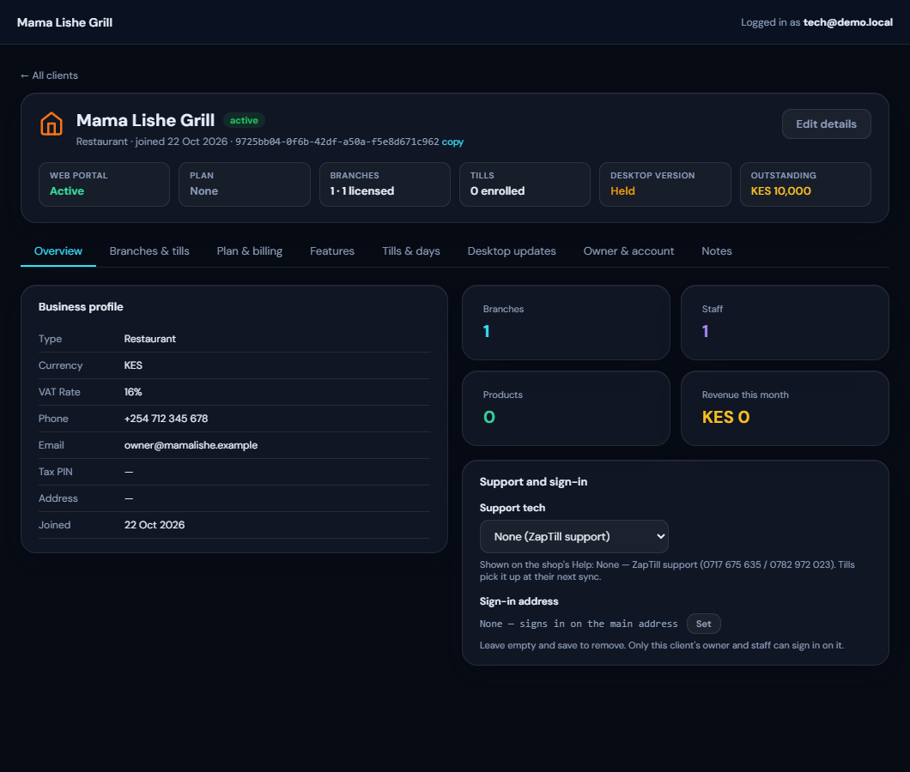

**If it fails**

| Message | Meaning |
| --- | --- |
| Auth creation failed | That email is already a ZapTill sign-in. Use another email or ask the owner which one they use. |
| Temporary password must be at least 8 characters. | Make it longer. |
| Plan shows **No licence yet** after creating | Normal. It changes to **Cloud trial** when you activate the first desktop licence (Step 2a). |

**Changing the owner's email later:** only from **Owner & account › Change email**, and only on purpose. This also moves the owner's staff record. Never ask the owner to sign up again with a new email: that creates a second "Owner" record.

## Step 2 — Turn on the licences and features

A new client can do nothing yet: the owner cannot sign in to the web dashboard and no till can join. Two licences fix that; the Features tab sets the rest. These buttons need a **super admin**; others see "Super admin only".

**Do them in this order: the desktop licence first, then web access.** The first desktop licence gives the client a free one-month cloud trial, but only if the client has never had web access. Enabling web access first, even for a minute, uses up the trial.

**2a. Desktop licence, per branch.** Open **Branches & tills**. Each branch shows "✗ Not licensed — desktop POS blocked" until you click **Activate licence**. Enter the one-off fee (or leave it blank to invoice later) and the M-Pesa or bank reference if paid. A desktop licence has no expiry. Repeat for every branch.

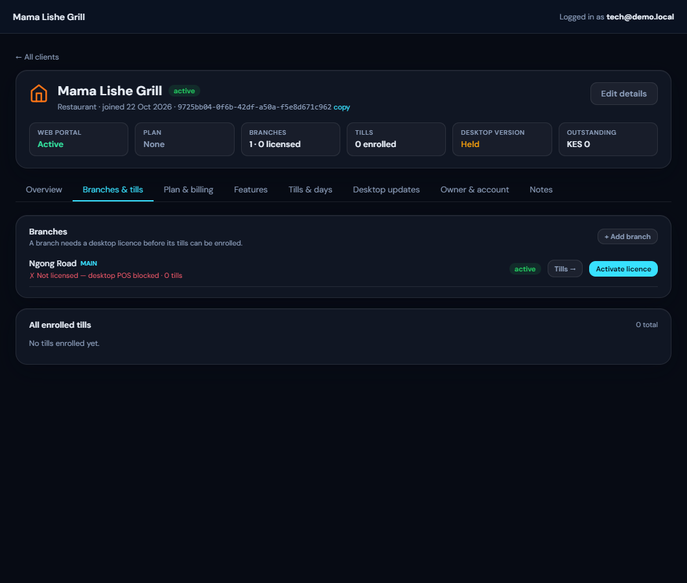

**The one-month cloud trial.** When you activate the client's **first** desktop licence, ZapTill switches web access on for 30 days and says so: "Licence activated. {Business} also gets a one-month cloud trial — the web dashboard until {date}. No invoice was raised for it."

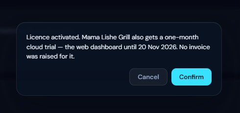

- **Once per client, ever.** A second branch's licence, or a licence revoked and activated again, never starts another trial. A client that ever had web access (switched on or off, or with an expiry date set) gets none.
- **No invoice** is raised for the trial. A licence fee you type raises only its own invoice.
- **What the admin portal shows:** the header's **Web portal** reads "Cloud trial — ends {date}" (amber) and **Plan** reads "Cloud trial". **Plan & billing** shows the trial with **Convert to paid** and **End trial**, and the **Cloud plan** card below it.
- **The owner's notice:** in the trial's last 7 days the owner (only the owner, never staff or a till) sees a line at the top of the dashboard: "Your cloud trial ends on {date} — contact ZapTill to keep the dashboard."
- **When it ends:** there is no 21-day grace as for a paid client. For 7 days the owner can still sign in and read reports, but the web POS is off ("Your cloud trial ended on {date}. Reports stay open for a few more days…"). After that, sign-in is refused with **Your cloud trial has ended** (code `CLOUD_TRIAL_ENDED`; screenshot in Step 3). **Tills keep selling throughout**: they run on the desktop licence.
- **End trial** stops it at once (the owner is locked out of the dashboard at once; tills are not affected).

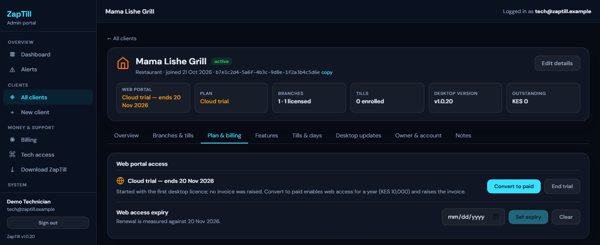

**2b. Web access (the dashboard and the online features), when the client pays.** On **Plan & billing › Web portal access**:

The cloud (web dashboard, online features and the tills' sync) is paid **per business, month to month** — KES 3,000 a month by default. Paying 3, 6 or 12 months ahead is welcome but carries no discount. The desktop setup stays a one-off per branch.

- **The Cloud plan card** (**Plan & billing › Cloud plan**): choose the **Period** (Monthly (month on month), 3 months, 6 months, 12 months, or Custom end date) and the **Amount per period** (it fills in KES 3,000 × months; type another amount if agreed) and click **Save plan**.
- **Turning web access on = Record payment.** Under **Record payment** choose what it covers, type the **Amount paid**, the **M-Pesa code** (for M-Pesa; a code can be recorded only once, on any client), the date paid and an optional note, and click **Record payment**. Web access is switched on, the period's invoice is marked paid (or a paid one is raised), the owner is emailed a short receipt, and the payment is listed with who recorded it. Payments are checked by hand for now; a monthly plan does **not** renew itself, each month needs a recorded payment.
- **Which dates it covers:** paying early adds a period to what is left (no lost days); paying within the 7 unpaid days covers the period that was invoiced, from its due date (due 23 Nov, paid 28 Nov → paid until 23 Dec); a locked client starts a new period from the day it pays.
- **There is no "Enable web access" any more.** The old KES 10,000 a year switch is retired; the button now reads **Record payment** and takes you there. (A client switched off by mistake whose paid-until is still ahead can be switched back on.)
- **Complimentary / manual paid-until** (super admin, special cases only): on the Cloud plan card choose the date and type the reason, then **Set complimentary**. Web access goes on to that date, no invoice is raised, and the reason is kept in the audit log.
- **During or after the trial:** **Convert to paid** takes you to **Record payment** — the first payment converts the trial.
- **Web access expiry** is the same date as the plan's paid-until. **Record payment** moves it; set it by hand only to correct it.
- **Clients whose licence was set before the plan** (an expiry date, no plan): ZapTill puts them on a plan by itself within the hour — 12 months at KES 36,000 unless their last invoice shows another period — and the note on the card says to check the period and amount. If their date had already passed, their billing starts on that day: an invoice, then the 7 days. Nobody is cut off by the change. A client with web access on and **no expiry date** is left as it was and listed as **No expiry set** — put it on a plan.

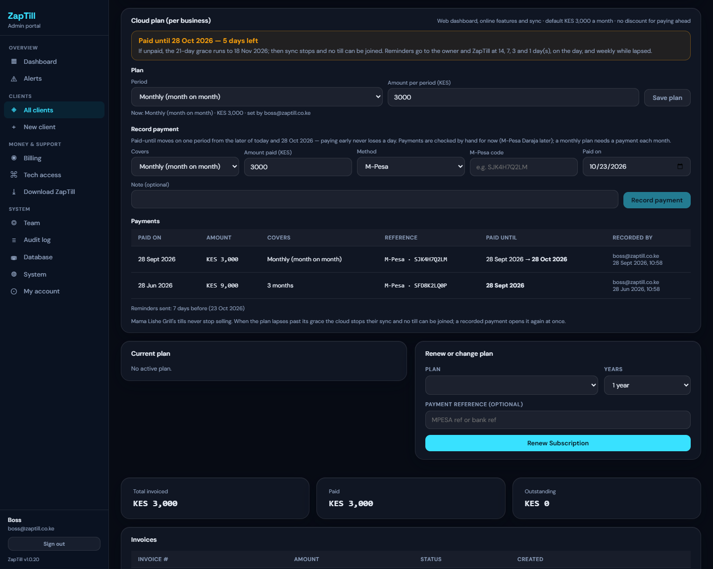

**The invoice.** On the first day of each billing period (the paid-until date; for a monthly plan, each month) ZapTill raises the invoice and emails it to the owner: the business, the invoice number, the period, the amount in KES, "Due: Now", and how to pay (M-Pesa, or WhatsApp or call ZapTill on 0717 675 635). It says nothing about when access would stop — by the owner's decision. ZapTill gets a copy.

**When a client does not pay.** For 7 days after the due date everything works and nothing on the dashboard warns the owner. At the end of the 7th day (midnight, Nairobi time) the business is **locked at once**:
- **The web dashboard is paused** for everyone, including a session already open: "Your ZapTill cloud access is paused. Call 0717 675 635 to renew." Sign-in shows the same.
- **Tills keep selling** exactly as before, cash and M-Pesa. Every sale is kept on the till.
- **The cloud stops syncing** that business's tills. A manager (never a cashier) sees at the bottom of the till: "ZapTill cloud subscription ended — N records kept on this till, sent when renewed (ZapTill 0717 675 635)".
- **No till can be joined or rejoined**: an enrolment code is refused with "This business's ZapTill cloud subscription has ended, so a till cannot be joined (or rejoined) until it is renewed…" (the code is not used up), and the admin portal will not issue a new code until the payment is recorded.
- **When the payment is recorded** everything opens again at once; each till sends what it kept within about 5 minutes.

A cloud trial is different: after its end, 7 days of reports only (sync stops at once), then sign-in is refused (Step 2a).

**Reminders go to ZapTill only.** The owner gets the invoice and, when paid, the receipt — nothing else. ZapTill (the admin alert email, and Telegram when set) gets: the invoice issued, a note on the 5th unpaid day ("locks in 2 days" — a call then may save the lock), the lock, and a trial's end; the morning check lists every locked client each day. The admin portal's client list has a **Billing** column ("Due in 5 days", "Unpaid 3 days (locks in 4 days)", "Locked 2 days", "No expiry set") and a filter for **Due (14 days)**, **Unpaid**, **Locked** and **No expiry set**.

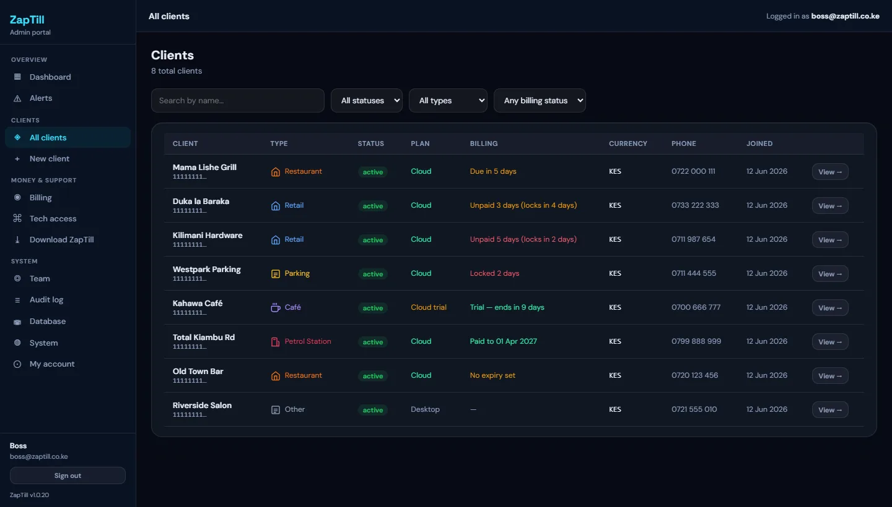

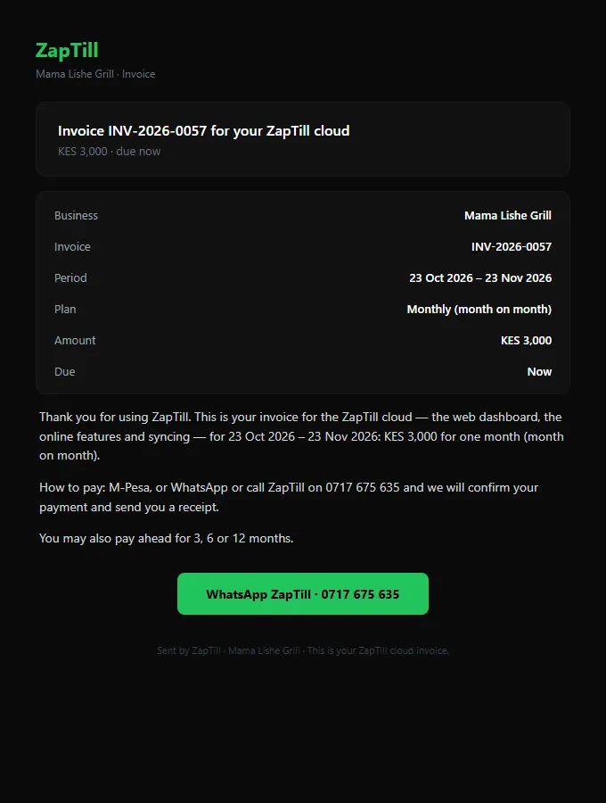

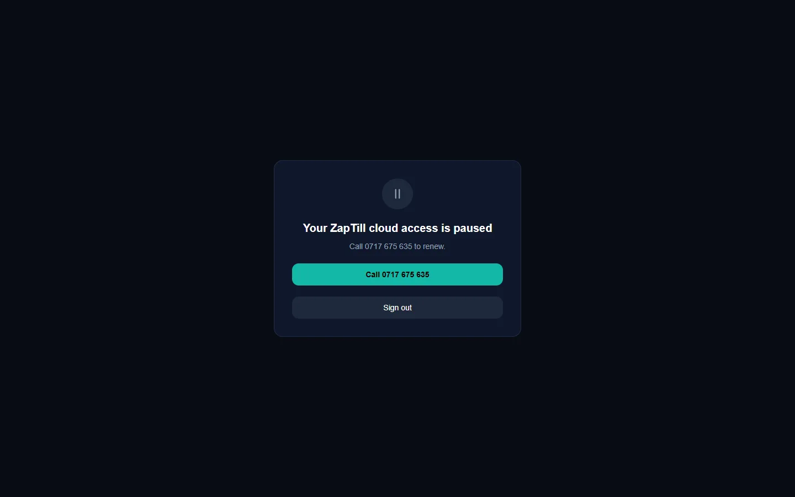

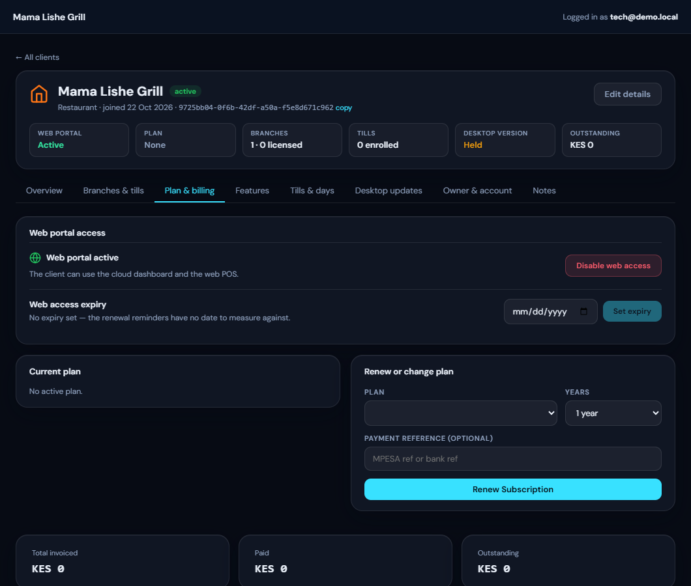

Without web access (and outside a trial) the owner sees "Web portal access not enabled" when signing in. Web access also unlocks the online-licence features on the till (offers, wastage, transfers, other branches' stock, labels, pictures and variants). After the due date there are 7 days of full access, then the dashboard is paused and the tills stop syncing at once. Tills keep selling throughout.

**2c. Features.** Open the **Features** tab. Changes take effect at once; tills pick them up at their next sync.

| Switch | Turn on when |
| --- | --- |
| App themes | The client wants their colours on the till and per-branch branding |
| Analytics | The client has paid for Analytics (premium) |
| Compact receipt layout | The client wants shorter receipts (some find it crowded) |
| Classic line spacing (4.23 mm) | A printer runs receipt lines together |
| Full-size receipt logo | The client wants a big logo (up to 36 mm) |
| Extra paper before the cut | The printer's cutter clips the last line |
| Kitchen tickets in the small font | Long kitchen orders need less paper (harder to read at a distance) |
| Separate approval PIN for managers (under **Staff options**) | Managers prefer a different PIN for approvals than for signing in |

**The approval PIN is off for every client by default.** Off, managers approve voids, refunds, sales on account and drawers with their own sign-in PIN, and the staff form has no approval PIN field. Switch it on only when the client asks: the staff forms on the dashboard and the till then show **Approval PIN**. An approval PIN set before 1.0.20 keeps working until someone removes it, whatever the switch.

The **POS switches** on this tab (delivery fee, cashiers see only their own sales, pay before kitchen and others) are read-only here. The owner sets them in the dashboard under **Settings › Business › POS options**.

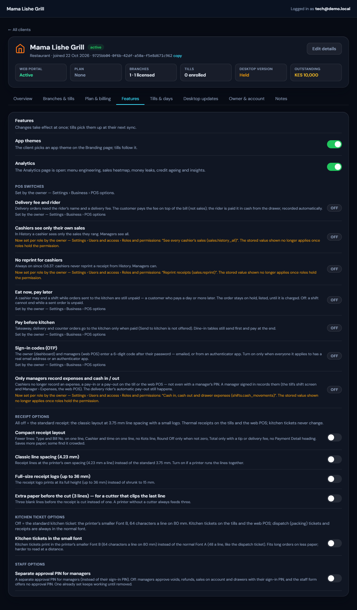

## Step 3 — The owner's first sign-in and business settings

The owner signs in on the web dashboard with the temporary password, chooses a private one, and you fill in the business details together.

1. Open **app.zaptill.co.ke** (or the client's own address) and sign in with the owner's email and temporary password.
2. ZapTill sends the owner straight to **Set your password** ("Your password was set by ZapTill. Please choose a new private password before continuing."). The owner types the **Password you were given**, then a **New password** (at least 8 characters, not the same as the old one) twice, and clicks **Save password & continue →**. Every dashboard page leads back here until the password is changed.
3. The owner lands on **Overview**. There is no setup wizard; the rest is done in **Settings › Business**.

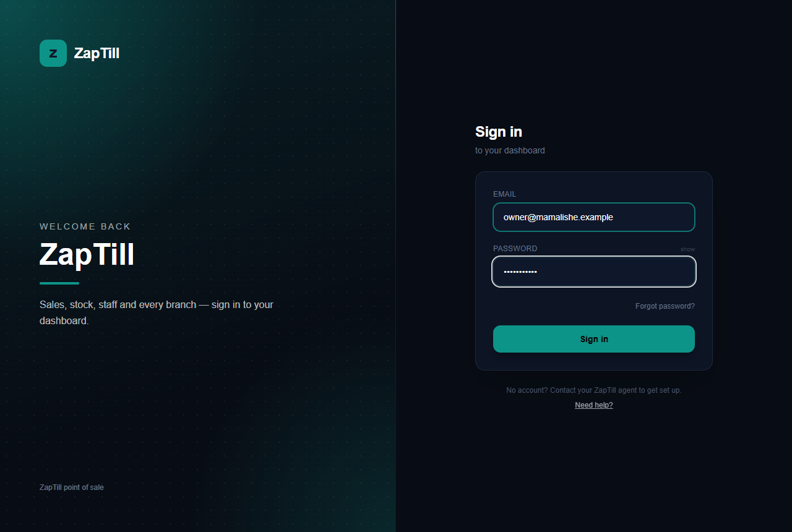

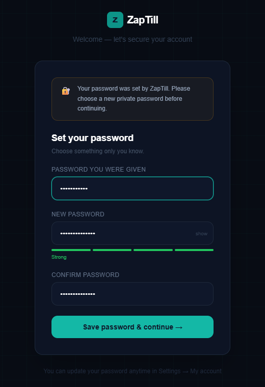

**What to tell the owner:** "The password I gave you was only for today. Choose your own now, one that I don't see, and keep it to yourself. ZapTill staff will never ask for it." Look away while they type it. The page asks again whenever ZapTill resets the owner's password from the admin portal (**Owner & account › Reset password**); after a reset through **Forgot password?** (an emailed code) the owner has already chosen their own, so it does not ask. Partners and accountants given web access set their own password from their invitation email and are never asked.

**When the cloud trial ends** (Step 2a) and no one has converted it to paid, the owner's sign-in shows this screen instead of the dashboard. **Contact ZapTill** opens WhatsApp to support; the fix is **Record payment** on the Cloud plan in the admin portal (Step 2b).

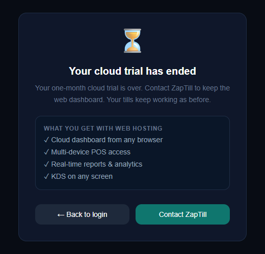

**Settings › Business › Profile**

- **Business details**: name, address, phone, contact email, Tax PIN (KRA), VAT rate, Catering/Tourism Levy, currency. Click **Save business details**. The currency locks once sales are recorded.
- **Receipt text**: **Header (top of receipt)** and **Footer (bottom of receipt)**, saved as you leave each field. Typical footer: address, phone, socials, a thank-you line.
- **Business day ends at**: the day cut-off. Sales before this time count to the night before. A bar open until 3 am sets 04:00; most restaurants keep midnight or 02:00.

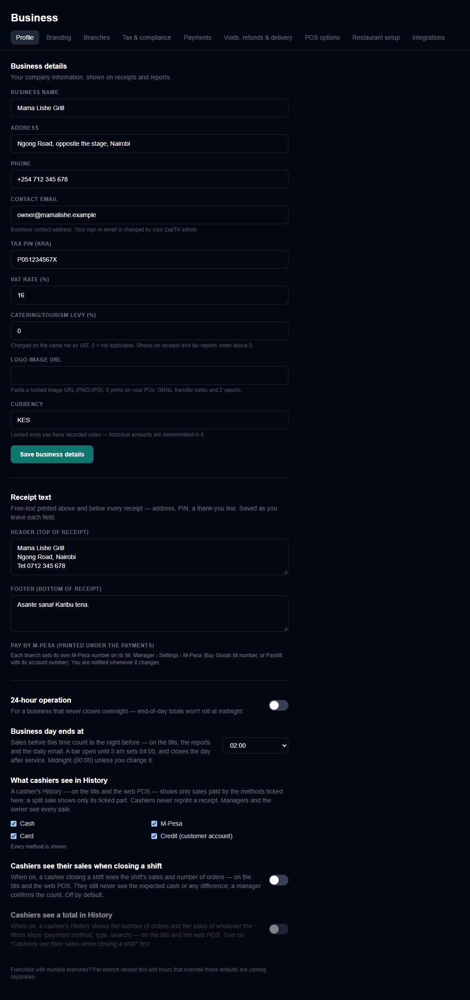

**Branches**: the owner can rename and edit branches, set the main one and deactivate one, but **cannot add a branch**. Add branches yourself in the admin portal (**Branches & tills › + Add branch**) and license each one (Step 2a). Each branch's detail page can override the receipt text, hours and payment methods for that branch.

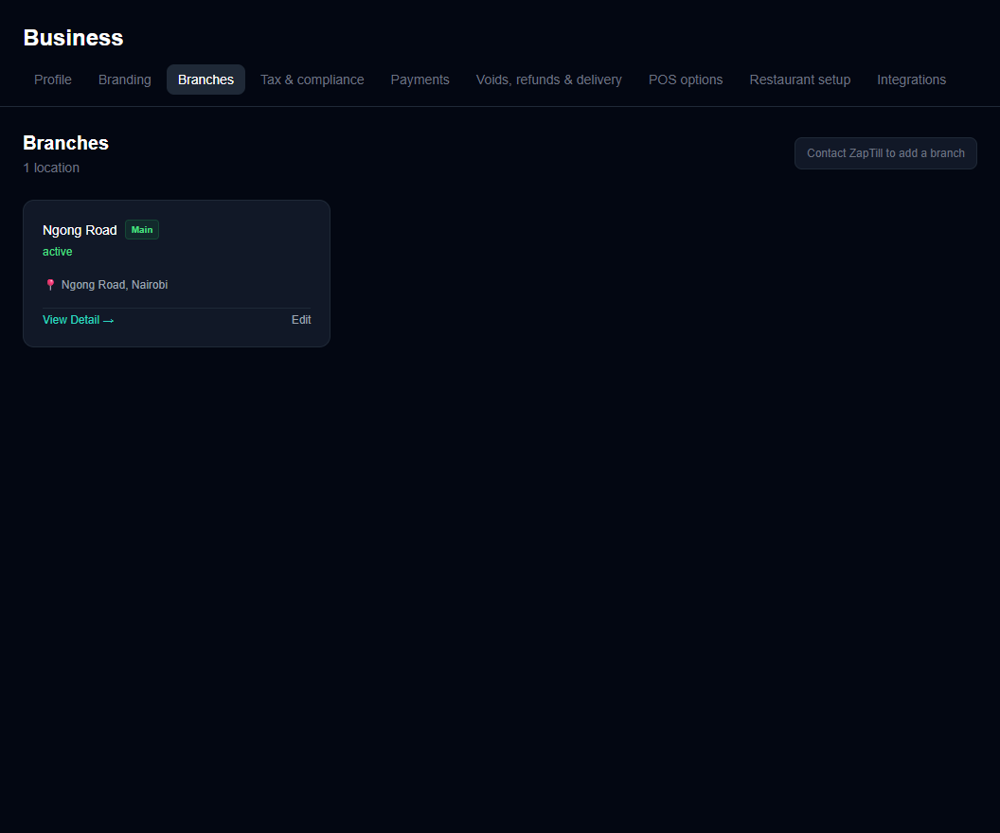

**Branding**: pick the accent colour, upload the logo (PNG or JPEG, shrunk to 250 KB or less, no SVG), and tick **Print logo on customer receipts** if wanted. Tills pick it up within about 20 seconds. With App themes on (Step 2c), the page also offers an app theme and **Per branch** colours and receipt footers (at most 6 lines, 48 characters a line on 80 mm).

**POS options**: delivery fee and rider, eat now pay later, pay before kitchen (these two only for a restaurant or café), loyalty points, and **Sign-in codes (OTP)**. With sign-in codes on, the owner gets a 6-digit code by email at every sign-in (10 minutes, 5 tries). Partners and accountants always get a code.

**When an item's stock reaches zero** (also on POS options). Ask the owner which they want. It applies only to items that track stock (Step 4), at each branch:

| Choice | What the till and the web POS do at zero stock |
| --- | --- |
| **Sell as normal** (the default for every client) | Sell anyway; the stock goes negative. As before 1.0.20. |
| **Show as sold out** | The item stays on the menu, greyed with a "Sold out" badge, and cannot be sold ("Chips is sold out." / "Only 2 of Soda left.") |
| **Hide when out of stock** | The item leaves the till menu and the web POS until stock comes in |

A till judges only stock it has heard from the cloud or the branch server: an item whose stock it does not know is always sold. Orders already sent to the kitchen are checked only at Charge. Only the owner (or someone with the POS settings right) changes it; tills follow at their next sync.

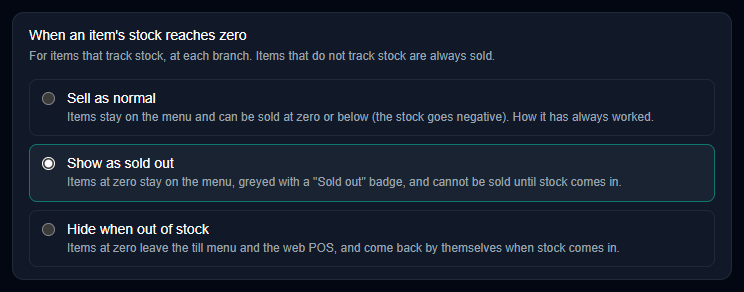

**If sign-in fails**

| Message | Meaning |
| --- | --- |
| Web portal access not enabled | No trial and no web access: Step 2b |
| Your cloud trial has ended | The trial and its reports-only week are over: **Record payment** on the Cloud plan (Step 2b) |
| A till says "ZapTill cloud subscription ended — … kept on this till" | Unpaid 7 days after the due date: **Record payment** (Step 2b); the till sends what it kept within about 5 minutes |
| Your ZapTill cloud access is paused | Unpaid 7 days after the due date: **Record payment** (Step 2b); the dashboard opens at once |
| Enrolment code refused: "…cloud subscription has ended, so a till cannot be joined" | Record the payment first (Step 2b), then use the same code |
| Invalid email or password | Wrong password; check caps and the temporary password |
| Too many failed sign-ins for this account | Locked for 15 minutes |
| This sign-in address belongs to another business | Wrong client address; use the main address |
| Could not email your sign-in code | Email delivery failed; try again in a minute |

## Step 4 — Load the menu

Load the whole menu from one Excel workbook, then add variants, extras and costs. For a restaurant or café the dashboard calls products **Menu Items** and categories **Menu Sections**. For a shop the same screens are the **Catalogue** (products and **Departments**); the steps are the same, and the upload is called **Product upload**.

1. Go to **Menu › Menu Items** and click **Menu upload**.
2. Click **↓ Template** and fill the workbook. Its sheets are **Products**, **Upgrades & Spices**, **Recipe** and **Ingredients**, plus a **Read me**.
3. Click **Choose an .xlsx workbook**. A preview appears.
4. Click **Apply {n} rows** and read the result: added, updated, skipped, and any new menus.

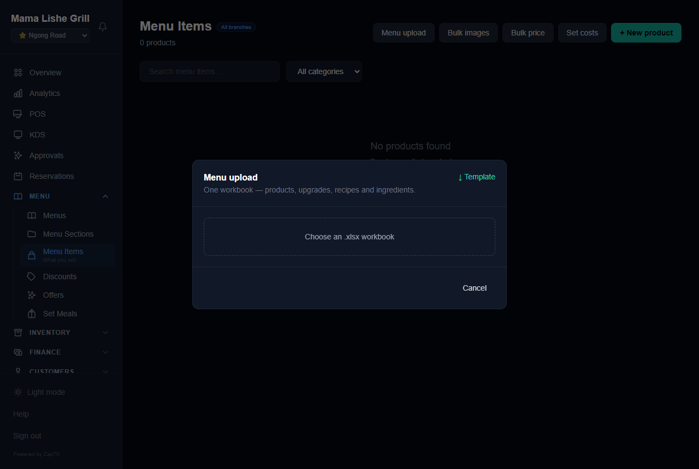

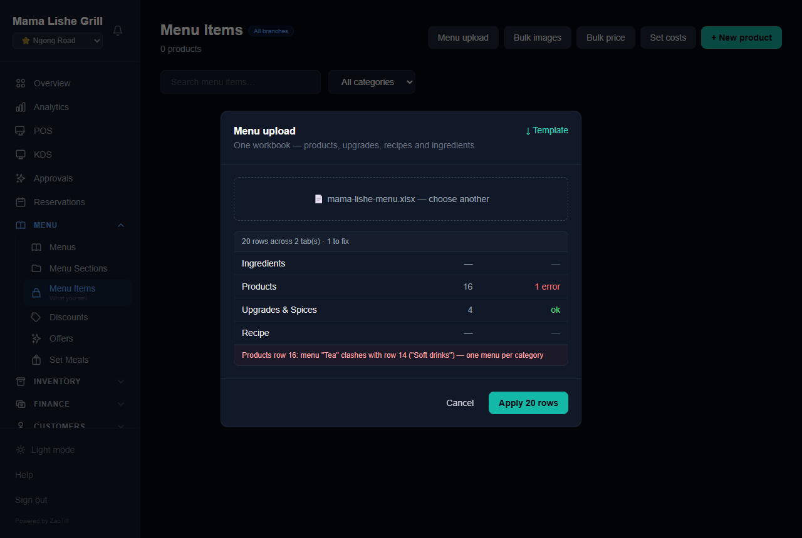

**Products sheet: the columns that matter on day one**

| Column | What to put |
| --- | --- |
| name | The item's name (required; matching key) |
| category | e.g. Grill, Drinks |
| price | Selling price, required for a new item |
| cost_price | What one serving costs you (needed for margins in Analytics) |
| is_kitchen | yes for food the kitchen cooks |
| track_stock | yes for bottled or packed stock you count |
| menu | Puts the item's category in a menu tab (Food, Soft drinks, Alcohol) |
| plu_code | A stable code, so items can be renamed later |

The sheet's rules: a row matching an existing item updates it and never duplicates it; a blank cell leaves the value as it is; DELETE clears it. At most 500 rows per upload.

**Variants and extras.** Put them in **Upgrades & Spices** (`product, group, type, option, price_added`), or open an item's **Variants** link. A **variant group** (e.g. Spice level: Normal / Spicy) lets the customer pick one option and can change the price. A **modifier group** (e.g. Extras: Extra Cheese +50) is an add-on the customer can pick several of. Variants print on the item's own line ("Chicken Burger - Spicy"); extras print under the dish on the kitchen ticket.

**Costs: don't skip this.** Click **Set costs** and enter what one serving costs, or give each item a **Recipe** of ingredients. Without costs, Analytics cannot show margins and lists the items under "Set these costs to see your real margins".

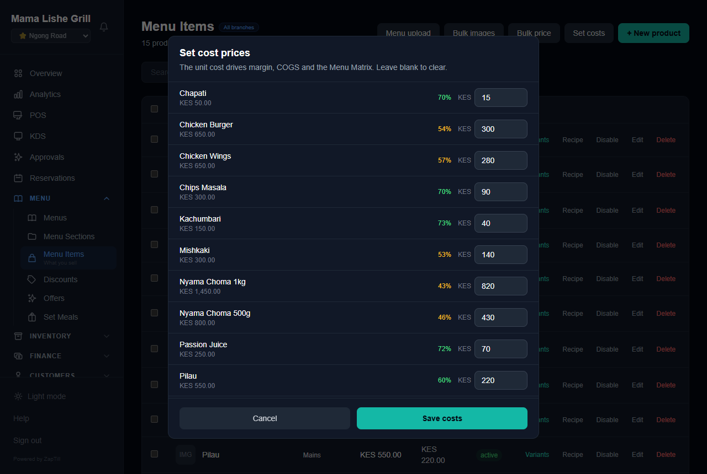

**Also on this page:** **Menus** (group categories into tabs on the till: one menu per category), **Combo Meals** (combo name, price, items; restaurant and café only), **Bulk images** (matched by barcode, then PLU, then exact name), and **Track stock** per item. Turn on **Track stock** only for items the client really counts: the zero-stock setting (Step 3) and other branches' stock work only on those.

**Menus (Departments in a shop) become tabs across the top of the till.** When the business has at least one menu with a category in it, the till and the web POS show a row of large tabs above the products: **All**, each menu in the owner's order, and **Other** for categories in no menu. A cashier taps a tab to see that menu; the ☰ panel then lists only that menu's categories. A search always looks through every menu. With no menus, the till keeps the ☰ category panel. So set up menus that make sense to a cashier (Food, Soft drinks, Alcohol; or Groceries, Beverages, Household), and check them on the till in Step 10.

**Barcodes and labels.** For a shop, or anything sold by scanning: **Menu › Products › Generate barcodes** gives every product without a barcode an in-store code (EAN-13 starting with 20 unless the numbering is changed), never touching one it already has. **Menu › Print labels** (on the till: **Manager › Stock › Labels**) sets the label size and prints on a label printer, A4 sticker sheets or the receipt printer; every label carries a barcode. The full steps, sizes and printer drivers (Xprinter, TSC, Zebra) are in the separate manual **Barcodes and labels** (`docs/Manuals/BARCODE-LABELS.html`, also as Word). Labels on the till need web access (the online licence).

**Stock at other branches (clients with more than one branch).** Anyone with the stock-view right (Cashier, Supervisor, Manager, Storekeeper, and Waiter at a restaurant or café, by default) can look up an item at the other branches: on the web **Inventory › Other branches** (**Stock › Other branches** for a shop), on the till **Manager › Stock › Other branches**. It shows quantities only, never costs. A partner of some branches sees only their own other branches. A manager with the stock transfer right can **Ask** another branch for an item (how many, an optional note, **Send request**). The other branch sees it under **Requests from other branches** and clicks **Accept and send** (it may send fewer or more) or **Decline** with a reason. An accepted request becomes an ordinary transfer: the stock leaves the sending branch at once and is received under **Transfers** at the asking branch. On the till's sale screen, a search for an item that is sold out here offers **Check other branches** (a long press or right-click on a tile does the same), read only. All of this needs web access and an internet connection.

**Upload problems**

| Message | Fix |
| --- | --- |
| menu "Tea" clashes with row 13 ("Soft drinks") — one menu per category | A category can be in one menu only; split the category |
| price is required for a new product | Add the price |
| invalid sold_by / track_stock / tax_type | Use each/weight/volume/piece, yes/no, or A–E |
| upgrade "X" needs one option at 0 | Give the upgrade group a free baseline option |
| Ingredients carry per-branch opening stock — pick a specific branch | Choose the branch in the top bar first |
| Maximum 500 rows per import | Split the file |

## Step 5 — Staff, roles and PINs

Every person gets a role and a 4–6 digit PIN; the role decides what they can do on the till and the dashboard.

1. Go to **Settings › Users and access › Staff members** and click **+ Add Staff**.
2. Keep **PIN Login** selected. Enter **Full name** and pick the **Role**.
3. Enter **Email** (used for sign-in) and a **PIN (4–6 digits)**. Give every person a different PIN.
4. Under **Branch access**, tick the branches they work at. With none ticked they get every branch.
5. Optional: **Hourly rate**, and single permissions under **This person's permissions** (pre-filled from the role).
6. Click **Add Staff**.

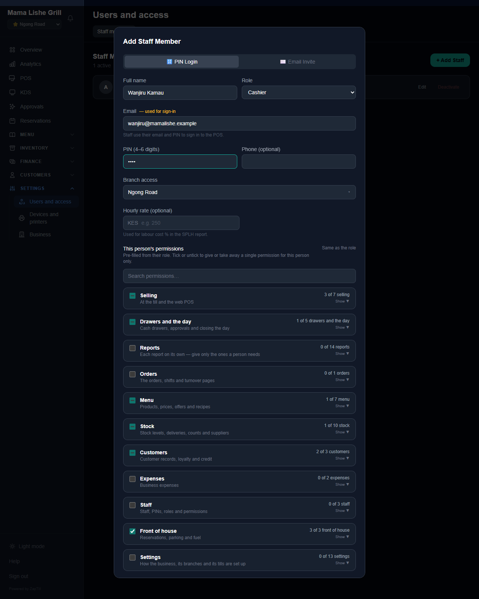

**Which role to give**

| Person | Role |
| --- | --- |
| Sells at the counter | Cashier (or Waiter for table service, restaurant or café) |
| Approves voids, refunds and sales on account at the till | Supervisor |
| Runs a branch | Manager |
| Runs the whole business, not the owner | General Manager |
| Menu, stock and kitchen | Operations Manager (or Kitchen Manager, restaurant or café) |
| Books and reports only | Accountant (reads) or Finance Manager (acts) |
| Receives and counts stock | Storekeeper |

Nobody can be given the owner's role, not even by the owner: for full rights use **General Manager**. Editing someone shows their real role; the owner's own role is locked ("Owner — the owner's role can't be changed here"), and the owner cannot change their own sign-in email or deactivate themselves (ZapTill support changes the owner's email: Step 1). A row marked **Not your sign-in account** is a second account on the owner's role: ask the owner, then move it to another role or deactivate it. There is no **Approval PIN** field unless you switched it on for the client (Step 2c). A cashier has no Void button: a supervisor or manager does voids. A supervisor or manager lands on the Manager screen after their PIN and presses **Open POS** to sell.

**Web dashboard access for a partner or accountant.** Add the person with **PIN Login** first. Then, on their row, click **Give web access** and confirm. They receive an email titled "You can now sign in to {Business} on ZapTill", set their own password, and enter a one-time code at every sign-in. Use **Revoke web access** to remove it.

**Which branches a partner sees.** A partner sees exactly the branches ticked on their staff record (none ticked means every branch). A partner of **every** branch gets the owner's branch picker, **All Branches** included. A partner of **some** branches (for example a partner who owns shops X, Y and Z of a client's four) never sees **All Branches** or any other branch's sales, stock, staff or name. With two or more branches their picker starts with **All my branches (3)**: every report, the Cockpit, orders, shifts, stock, the watch list and Analytics (with **Branches** comparing their own) show their branches added together. A few screens work one branch at a time, such as the monthly pack, tables, the kitchen screen and eTIMS; there the page says **Pick one of your branches for this**. To record a sale, an expense, a count or any other change, they pick one of their branches first; in **All my branches** the cloud refuses changes with the same words. Tick the partner's branches before you click **Give web access**.

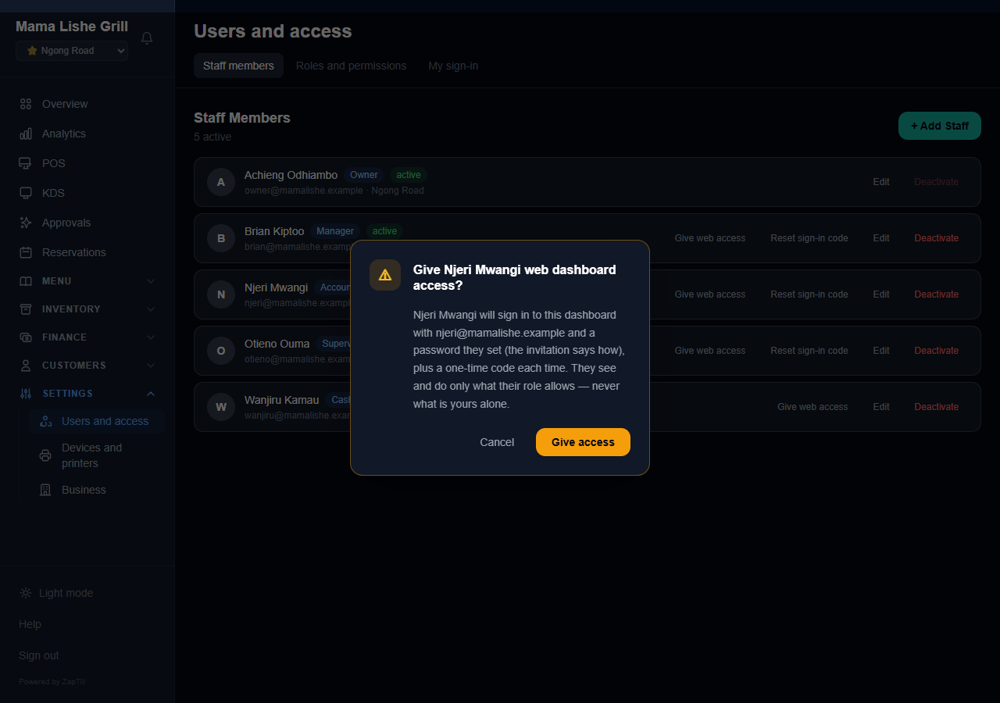

**Custom roles:** **Roles and permissions › + New role**, start from an existing role, then tick permissions. Changes apply at the person's next sign-in or till refresh.

## Step 6 — Payments, M-Pesa and credit accounts

The dashboard sets which payment methods the business takes; the M-Pesa number is set on each branch's till.

**Payment methods.** **Settings › Business › Payments**. On by default: Cash, M-Pesa, Card, Glovo and On account. Tick others the business takes (Airtel Money, bank transfer, delivery apps…) and save. A branch can choose its own on its detail page.

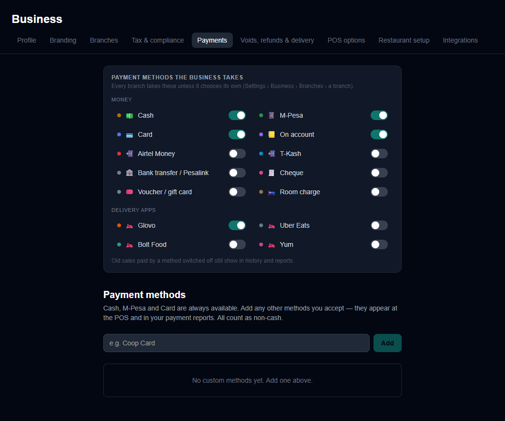

**M-Pesa number (on the till, by a manager).** On the till, open **Manager › Settings › General › M-Pesa for this branch**. Choose **Buy Goods** and enter the **Till number**, or **Paybill** with the **Business number** and the account number. Click **Save**. It prints large and centred on every receipt ("BUY GOODS:" then the number), and the owner is told whenever it changes. Numbers are 5 to 8 digits.

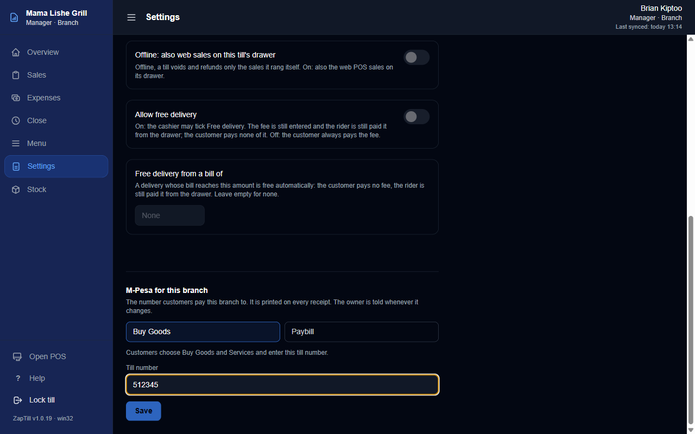

**Cash drawer.** No setting: cable the drawer to the receipt printer. It opens when the **Receipt** station prints (Step 9).

**Credit accounts (sales on account).** **Customers › Credit Accounts** lists customers who buy on account, with Limit, Owed and Available, and **Manage →** for limits, repayments, adjustments and statements. A manager confirms or disputes every credit sale under **Credit sales to confirm**; this never blocks the day close. On the till, **On account** appears only when the branch takes it, at least one customer has a credit account, and the cashier may view customers.

**Giving a customer credit.** Credit goes only to a customer already in the system. Three ways, all on the web dashboard:

1. **An existing customer:** **Customers › Credit Accounts › + Give credit**. Search by name or phone, pick the customer (each shows "No credit yet", or "Limit KES … already — this changes it"), type the **Credit limit (KES)** and click **Confirm credit limit**. The customer then appears in Credit Accounts.
2. **On the customer's profile:** **Customers**, open the customer, and set **Credit limit** (0 removes it), then **Save**. "Credit limit set to KES … They now show in Credit Accounts and at the tills."
3. **A new customer:** **Customers › + New Customer** has an optional **Credit limit**. If the customer is saved but the limit is not, the screen says so; set it on the profile.

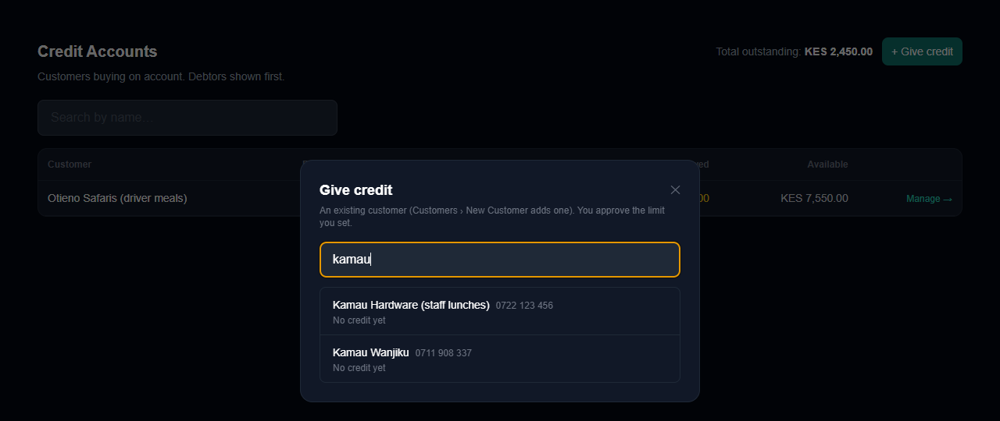

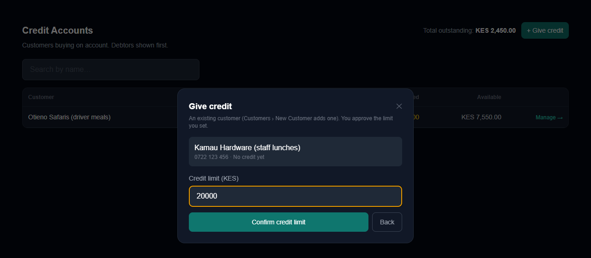

**Who sets a credit limit: the owner or a manager.** Giving, changing or removing a limit (setting it to 0) is for the business owner and for staff on the built-in **Manager** role only. The owner does it on the web dashboard (**+ Give credit**, the customer's profile, **+ New Customer**). A manager does it in the web POS: **Manager › Credit**, open the customer, **Credit limit**, **Save**. Customers belong to the whole business, so a manager can set the limit of any customer, and the branch they did it from is recorded. Only the role ZapTill created as Manager counts. A role the business made itself and called "Manager", a built-in Manager role renamed to something else, General Manager, Finance Manager, Supervisor and partners all get the line "Only the owner or a manager sets credit limits." and no box, and the cloud refuses them too. A till never sets a limit, and neither can ZapTill staff in the admin portal. Every grant, change or removal is recorded with who, from which branch, when, and the old and new limit, and shown on the customer's profile (below). Tills pick up a new credit customer at their next sync.

**Who approves credit sales (optional, the owner's choice).** **Settings › Business › Credit approvals** (the owner only). Off by default: as before, anyone with the **Customer credit** right approves a sale on account (a cashier enters such a person's PIN at the till), within the customer's limit. Turn **Who approves credit sales** on and tick, for each branch, the staff who may approve (only people who work at that branch are listed), then **Save**. From then on every sale on account at that branch, on the till and on the web POS, needs one of them or the owner: when the seller is on the list it is approved automatically; anyone else types the PIN of someone on the list ("Approver's PIN — someone the owner chose"). A manager who is not on the list is refused. Nobody ticked at a branch means only the owner approves there. The limit always applies: no approver can sell past it. The tills keep the list with their credit customers, so it works offline; a change reaches a till at its next customer list (within a minute online).

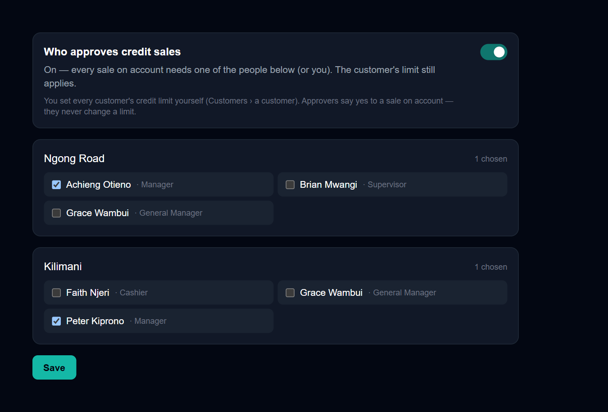

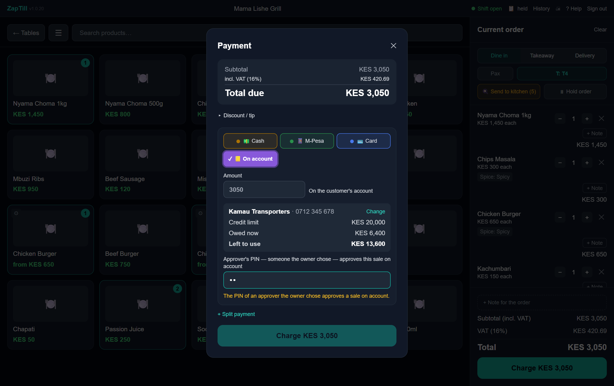

**Credit history.** **Customers**, open a customer: under the credit limit, **Credit history** lists every limit change (who, from which branch for a manager, when, old → new) and their recent sales on account with who sold each and who approved it.

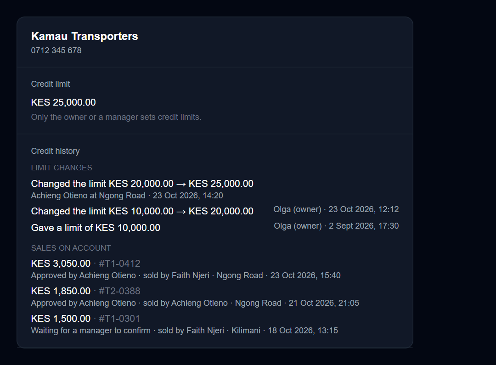

## Step 7 — Install ZapTill on the till PC and join it

A till joins with the **Business ID** plus a **single-use enrolment code** that expires 15 minutes after you create it, so create codes on site.

**7a. Download the installer (admin portal).** Download it before the visit, on your own laptop, and bring it on a USB stick:

- **For this client:** client › **Desktop updates** › **Download ZapTill**. The version approved for that client comes first ("Approved for this client"), then the latest release. Use the approved one.
- **Without a client:** sidebar › **Money & support › Download ZapTill** (the latest release).
- A super admin also gets **Another version:** to pick any complete release. Other admins may download only the latest release or the version approved for the client named.

Click **Download**: the browser saves `ZapTill-<version>.exe` itself. Each click gets a one-use link valid for 2 minutes, so click again if a download did not start. Every download is recorded in the admin audit log (who, which version, which client).

Beside each version are its size and checksum, with the PowerShell line to check the file on the PC, e.g. `Get-FileHash .\ZapTill-1.0.20.exe -Algorithm SHA256`. The hash it prints must match the one shown.

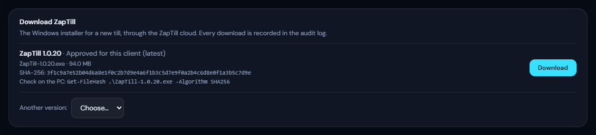

If the card says **Installer downloads are not set up on this server**, the cloud has no installer source. A ZapTill developer sets one of two settings on the cloud: `DESKTOP_DOWNLOAD_BASE_URL` (ZapTill's own download server; used first when set) or `GITHUB_RELEASES_TOKEN` (GitHub releases, which also works once the repository is private). The installer always comes through the ZapTill cloud; the source address and any token never reach your browser.

**7b. Install.** Run the approved ZapTill installer (`ZapTill-<version>.exe`) on the till PC as an administrator. It is not code-signed: if Windows SmartScreen appears, click **More info › Run anyway**. The installer:

- adds firewall rules for the branch server (TCP 4100–4103) and server discovery (UDP 4199);
- registers **ZapTill start at sign-in** (starts 45 seconds after Windows sign-in) and **ZapTill Updater** (installs approved updates without a Windows prompt);
- creates desktop and Start-menu shortcuts.

Updates are approved per client in the admin portal (**Desktop updates › Choose a version… › Approve**). Until then tills stay on the version they run.

**7c. Create the enrolment code.** In the admin portal, on the client's **Branches & tills** tab, click **Enrol till** next to the licensed branch and enter how many tills (1–20). Copy the **Business ID** and one **Code** per till. Codes are 10 characters, single-use and tied to that branch.

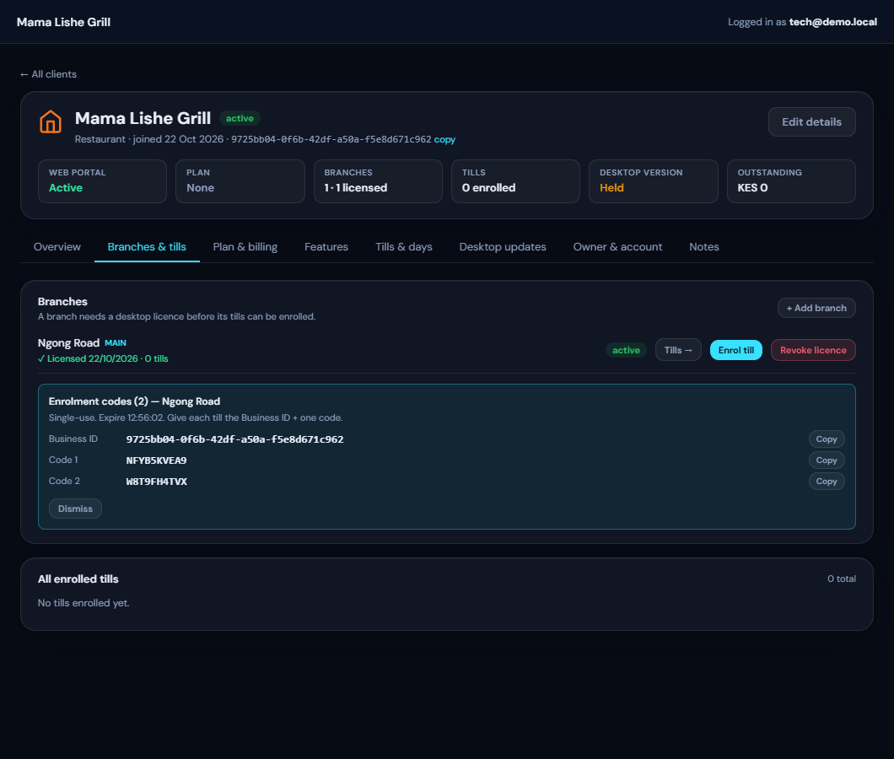

**7d. First run on the till.** Open ZapTill. The **Device setup** has three steps:

1. **Find the server.** ZapTill looks for a branch server on the network. For the **first or only till**, or for the PC that will **be** the branch server, click **Set up without a server**. For an extra till, choose the server (Step 8) — and check the business and server name first: the search lists every ZapTill server on the network, including other businesses'.
2. **Server address.** Type the ZapTill cloud address `https://api.zaptill.co.ke`. The box is empty: the grey address in it is only a hint, so type it in full. Click **Test connection** until it says "Connected — ZapTill server responded", then **Continue**.
3. **Activate this device.** Enter the **Business ID** and the **Enrolment code**, then click **Activate**. This step needs internet.

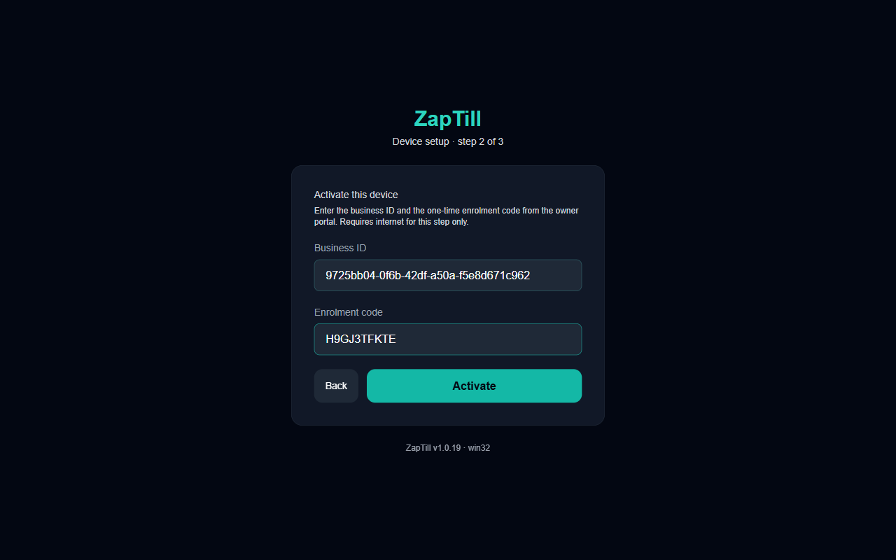

**7e. Branch and role.** After "Activated for {business}":

- **Branch** is fixed by the enrolment code.
- **Device role**: **Till** (sells), **Branch server** (sells, and other tills sync to it) or **Office** (a branch server that cannot sell: reports and day close only).
- **Terminal code**: T1, T2, T3… Every till at a branch needs a different code; it prefixes every bill number (T1--1042).
- **Device name**: e.g. Counter, Bar, Front till 1.

Click **Complete setup**. The screen locks; changing it later needs a technician (Step 11). The till opens on the PIN screen.

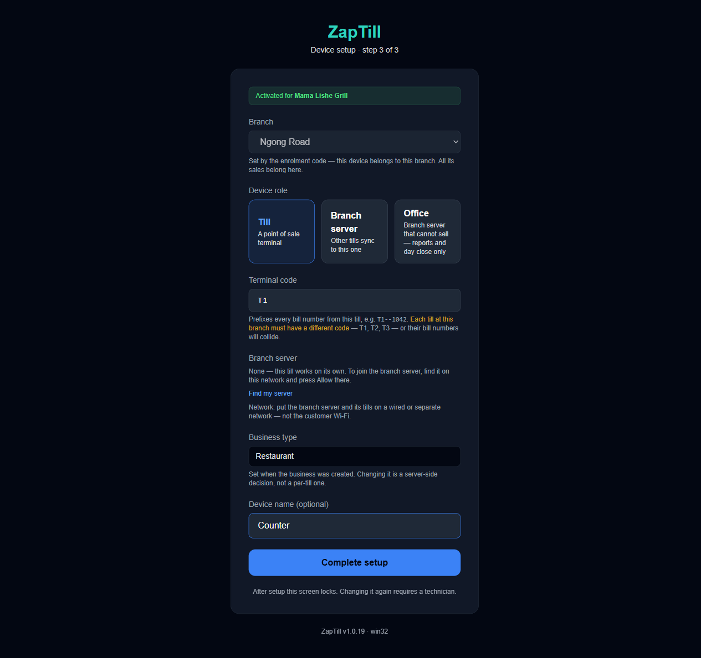

**There is no approval step for a till:** redeeming the code approves it. The dashboard's **Devices** approval is only for cashiers signing in to the web POS from a new browser. The new till appears under **Settings › Devices and printers › Terminals** after its first sign-in.

**If it fails**

| Message | Fix |
| --- | --- |
| The server did not accept that enrolment / Invalid, expired or already-used code | Create a new code (15-minute expiry, single use) |
| Could not issue an enrolment code — Assign a desktop licence to this branch | Step 2a |
| That looks like a branch server address. Port 4100… | Put the cloud address here, not the branch server's |
| Something answered but it is not the ZapTill server (HTTP 404) | Remove any path after the address |
| This till is already joined to its business | Rejoin from the Tech page (Step 11) |
| This branch has no desktop licence (PIN screen) | Step 2a |

## Step 8 — Branch server and extra tills

A branch with more than one till needs one **branch server**. Every other till joins through it and keeps selling, and in step, even when the internet is down.

**8a. Set up the server first.** On the PC that will be the server, follow Step 7 with its own enrolment code, and at **Device role** choose **Branch server** (or **Office** for a back-office PC that does not sell). Write down the **Branch access code** it shows, for support; tills never type it.

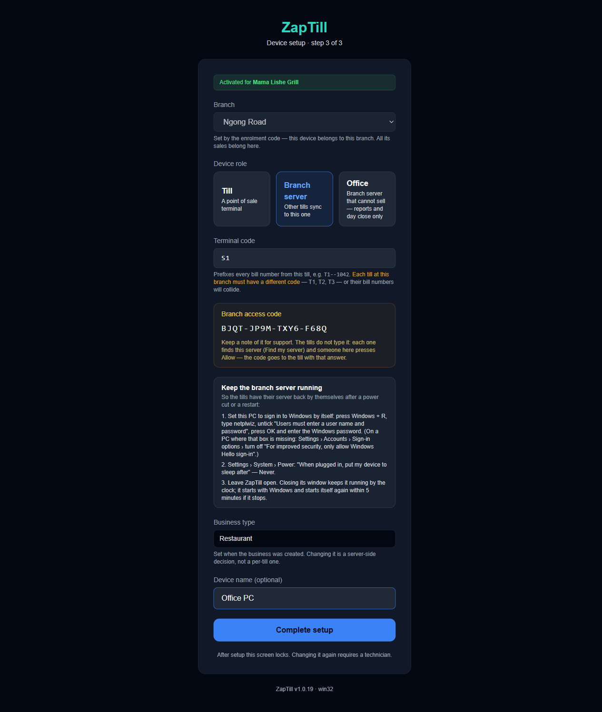

Make the server always available, as the setup screen asks:

- [ ] Windows signs in by itself (run `netplwiz`, untick "Users must enter a user name and password")
- [ ] **Settings › System › Power**: sleep when plugged in = **Never**
- [ ] Leave ZapTill open; closing its window keeps it running in the tray, and it restarts itself within 5 minutes if it stops
- [ ] Both PCs' Windows network is set to **Private**, on a wired or separate network, not the customer Wi-Fi

**8b. Join each extra till.** No enrolment code is needed on an extra till.

1. On the new till, at setup step 1 (or **Tech › Find my server**), choose the branch server. Check the business and server name.
2. The till shows **Now go to the branch server and press Allow**, with a **Security code**.
3. On the server, **A till wants to join this branch server** appears over every screen, with the till's name and IP and the same security code. If the codes match, click **Allow**; otherwise click **Deny**. The server needs internet at that moment.
4. The till carries on by itself: give it a unique terminal code (T2, T3…) and its device name.

The request waits 10 minutes.

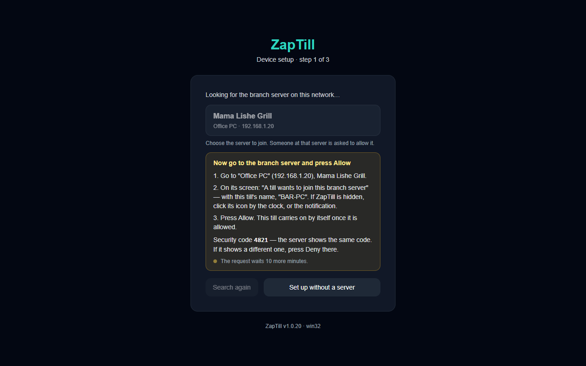

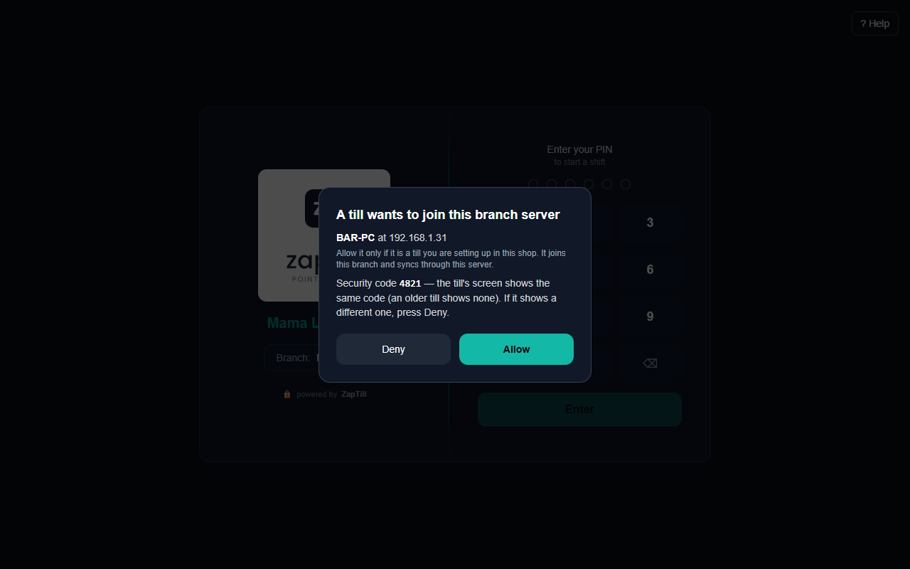

**Check it worked.** On a till's **Tech** page, **Shop network** reads "Encrypted" and **Branch sync** shows Reachable for each item. On the server, **Distribution to the cloud** says "Nothing waits — every record on this server is on the cloud".

**Ports.** The server listens on TCP **4100** (falling back to 4101–4103) and answers discovery on UDP **4199**; the installer opens both on the Private profile only. Only one copy of ZapTill runs at a time: opening it again just brings the running window forward.

| Message | Fix |
| --- | --- |
| No branch server answered on this network | Server PC on, ZapTill running, both networks Private, same network |
| The server needs the internet to add a till | Restore the server's internet, then press Allow again |
| The request ran out — ask again | Ask again from the till and Allow within 10 minutes |
| This till is already joined to this branch server | Revoke it on the server (Close Branch › Show tills › Revoke this till), then join again |
| …still reachable. Promoting now would put TWO servers on this branch | Demote or disconnect the old server first |

## Step 9 — Printers and stations

Printing is set in two places: the dashboard decides **what** prints at each station, and each till decides **which printer** a station uses. **Printing is OFF on a new till** — nothing prints until you switch it on (9b).

**9a. Stations, on the dashboard.** **Settings › Devices and printers › Print stations**. Add a station per job and pick its type:

| Type | Prints | Example |
| --- | --- | --- |
| Kitchen | Only what is cooked, no prices | Grill, Kitchen, Bar |
| Dispatch | Everything that goes in the bag, drinks included, no prices | Packing |
| Receipt | The customer receipt, and opens the cash drawer | Till |

Then click the category chips on each kitchen or dispatch station. A receipt station prints the whole bill. Until any station exists, tills use the built-in Kitchen, Dispatch and Till stations.

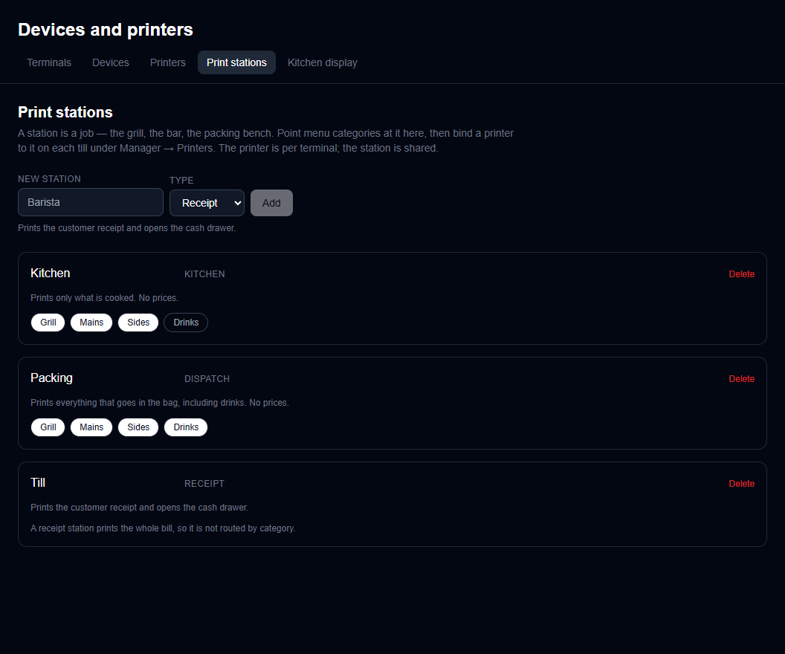

**9b. Printers, on each till.** On the till: **Manager › Settings › Printing › Printers**.

1. Switch on **Print through these printers**. It reads "OFF — nothing will print. Turn this on before trading." until you do.
2. Pick a station on the left. Under **Printer**, choose a printer plugged into this PC from **Pick a printer on this machine…**, or type a **network printer's IP** (e.g. `192.168.1.50`; port 9100 is assumed).
3. Set **Paper width** to the roll actually loaded: **80mm** or **58mm**. A mismatch is the commonest cause of wrapped receipts.
4. Click **Test print**. A good print says "Printed {bytes} bytes in {ms}ms"; the preview shows exactly what the printer will produce.
5. Repeat for each station. A station with no printer on this till is normal when another till prints it.

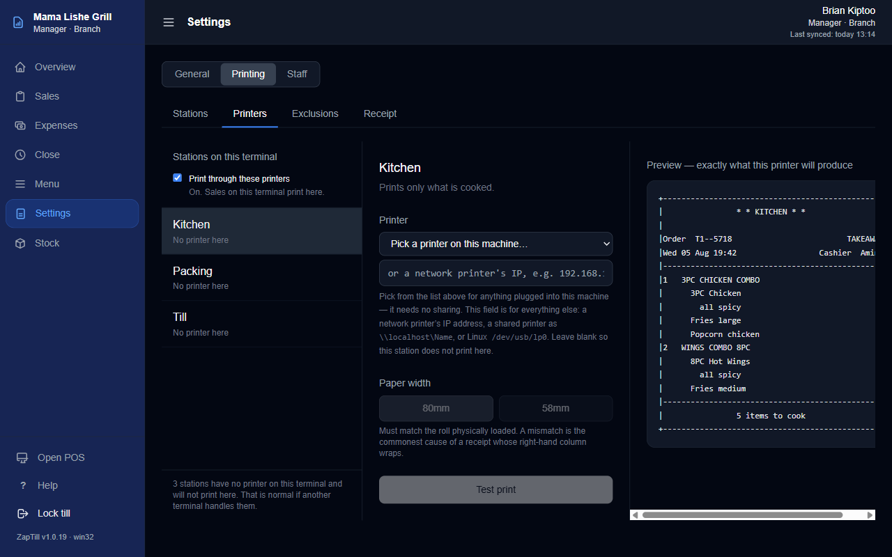

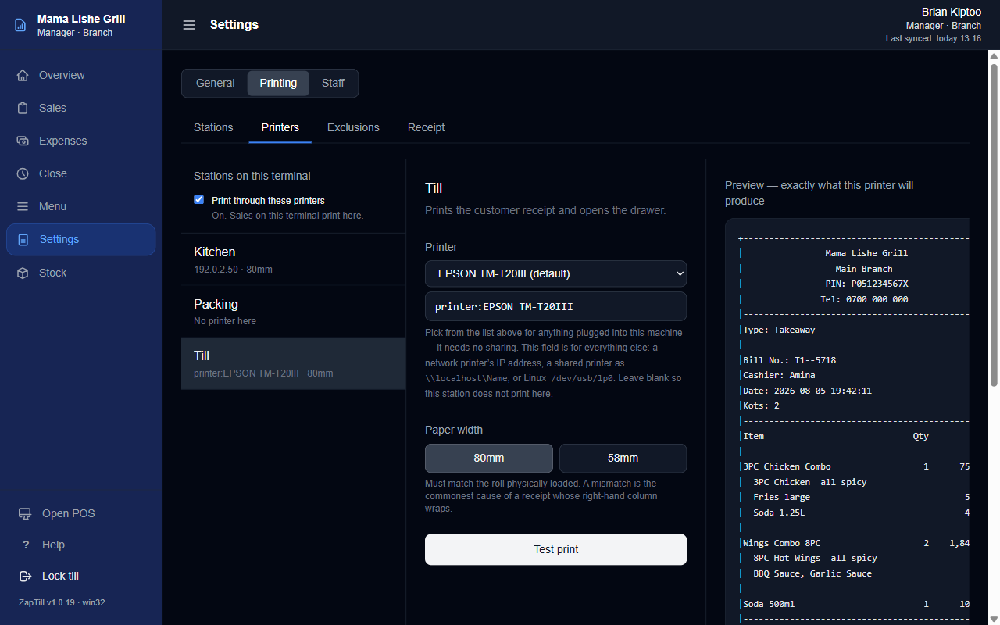

**What prints where**

- **Kitchen ticket:** kitchen items only, bold normal-size dish names, variants on the dish's line ("Chicken Burger - Spicy"), extras and notes under the dish.
- **Dispatch ticket:** the whole order in the same format, for packing.
- **Receipt:** the customer copy, with "BUY GOODS:" or "PAYBILL:" and the number centred and bold. It opens the cash drawer.
- The **Receipt** tab on the till holds the header and footer text for the whole business.

**Kitchen display (optional).** The owner opens **Settings › Devices and printers › Kitchen display**, picks the branch, clicks **Generate token** and copies it. Open `/kds` on the kitchen screen and paste the token once. Generating a new token replaces the old one: the old screen then asks to be set up again.

| Message | Fix |
| --- | --- |
| timed out after 8000ms connecting to …:9100 / Looks like the printer is off or unreachable | Printer power, cable or IP address |
| Windows took too long to accept the job | Press Test print again; clear stuck jobs in Windows' print queue |
| the spooler does not recognise that printer name (1801) | Re-pick the printer from the list |
| the print spooler service is not running (1722) | Start the Print Spooler service in Windows |
| Send to kitchen is greyed out | Printing is switched off on this till (9b step 1) |
| The sale is saved, but this did not print | Fix the printer; a manager reprints from History |

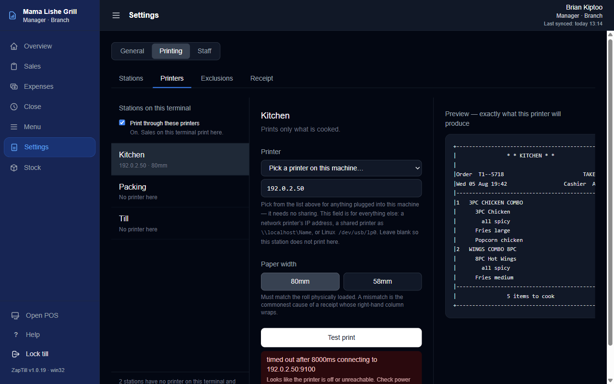

## Step 10 — Test run with the client

Run one full trading day in ten minutes with the client watching: sell, print, pay, void and close. Fix anything that fails before you leave.

- [ ] **PIN sign-in.** A cashier enters their PIN and presses **Enter**.
- [ ] **Opening float.** **Open your drawer**: count the cash in the drawer, enter it (0 if empty), **Start selling**.
- [ ] **Menu tabs.** If the business has menus (departments), the sale screen shows them as large tabs across the top (**All**, each menu, **Other**). Tap each one and check the right items appear; a search finds items in every menu.
- [ ] **Sell with a variant and an extra.** A restaurant opens on **Tables**; press **Takeaway** for the menu. Tap an item with a variant, pick it (e.g. Spicy) and an extra (e.g. Extra Cheese), then **Add to order**.
- [ ] **Kitchen ticket.** Press **Send to kitchen**. Check the kitchen ticket shows "CHICKEN BURGER - SPICY" on one line and "+ Extra Cheese" under it, and that the dispatch ticket prints.
- [ ] **Split payment.** Press **Charge KES {total}** (there is no "Pay" button). Pay part in Cash, press **+ Split payment**, put the rest on M-Pesa with its reference, then **Charge**. Check the receipt: items, the BUY GOODS number, and the cash drawer opening.
- [ ] **Sale on account.** Choose **On account**, pick the customer, have a manager enter their PIN, then **Charge**. The receipt shows the balance owed.
- [ ] **Void.** A supervisor or manager signs in, presses **Open POS › History**, opens the sale, **Void / Refund**, picks a reason, enters the manager PIN and **Confirm Void**.
- [ ] **Close the shift.** The cashier presses **Shift open › Close shift**, enters the counted cash (with the float) and the M-Pesa total. This is a blind count: the cashier never sees the expected figure.
- [ ] **Close the day.** A manager opens **Manager › Close › Close Day**, confirms each shift (Expected vs Cashier vs Manager, by method), counts the cash and presses **Count verified — close the day**.
- [ ] **Close the branch** (only on a branch server): **Manager › Close › Close Branch**, tick that the totals are checked, **Close branch**.
- [ ] **Check the dashboard.** Overview shows the sales; **Tills & Days** shows the till and its last sync; **Orders** lists the test sales.
- [ ] **Daily email.** **Settings › Business › Integrations › Daily Report Email**: set the send time and recipients. It sends once a day at or after that time (default 21:00).

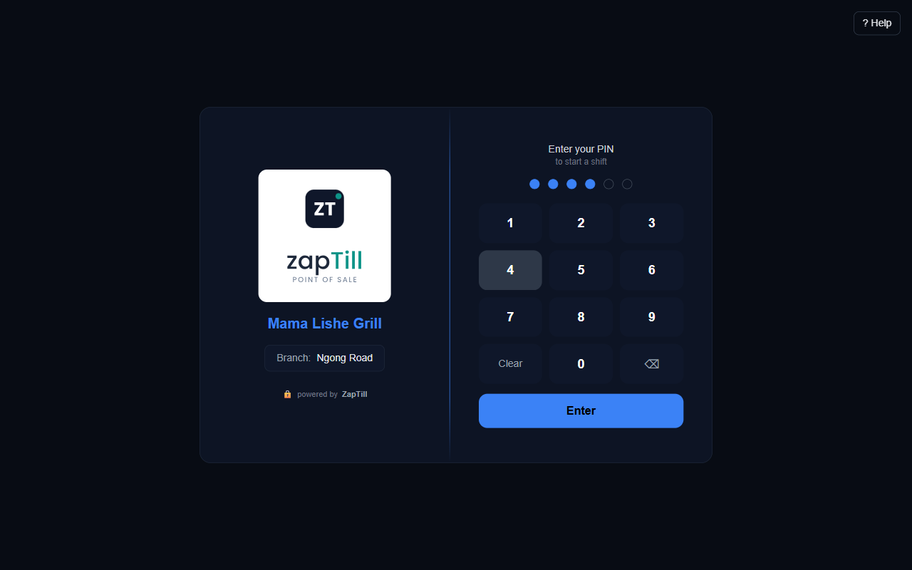

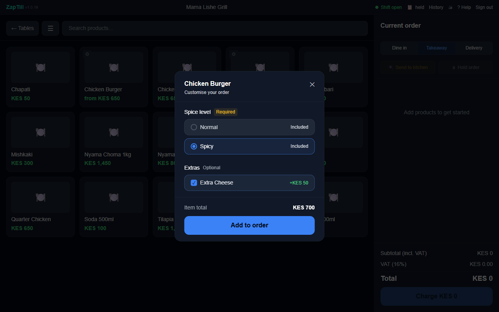

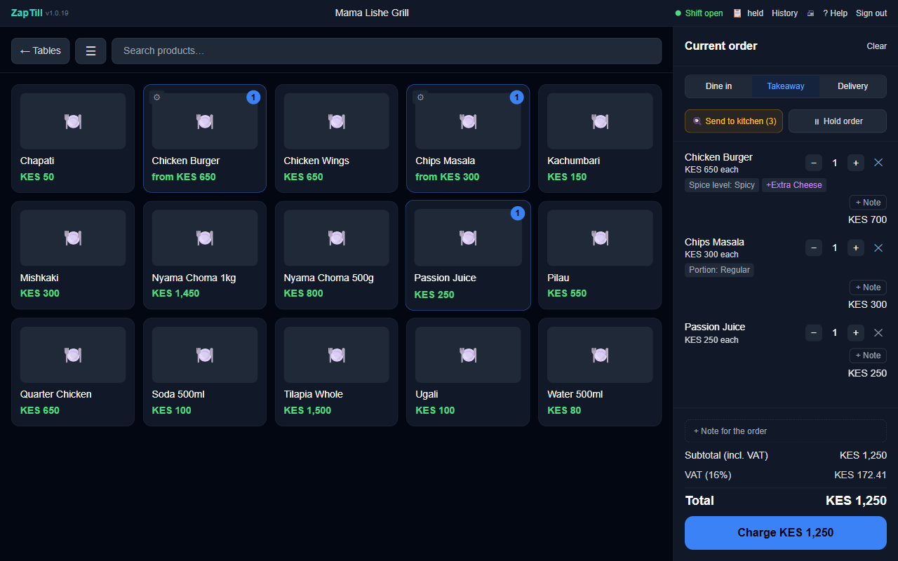

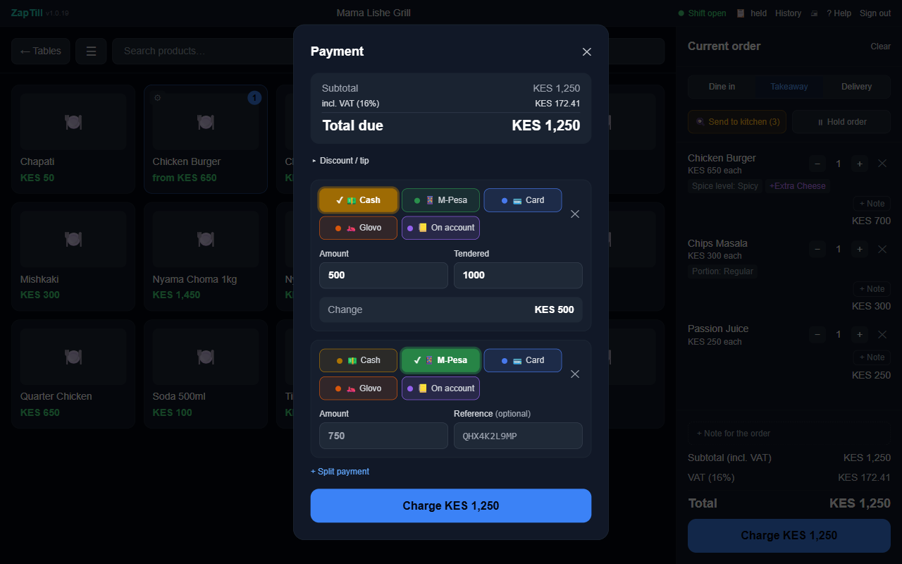

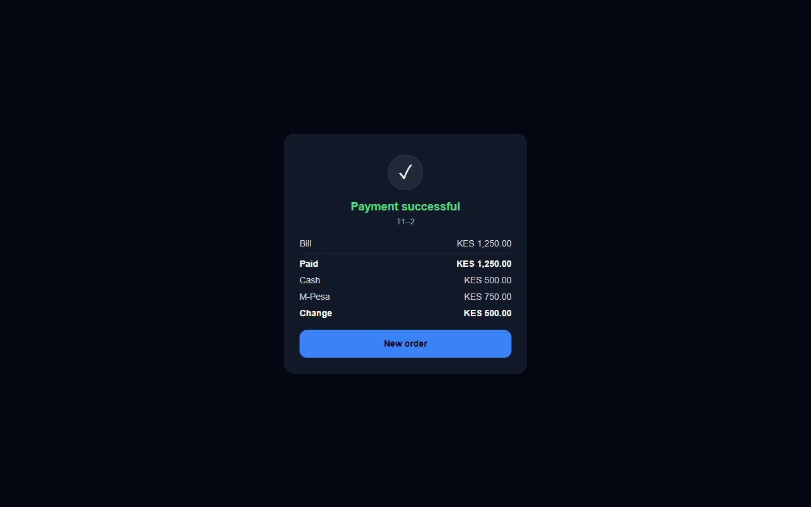

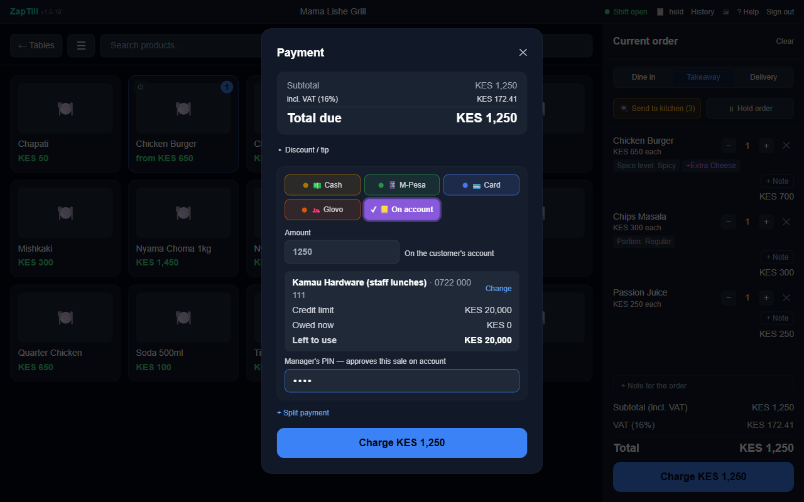

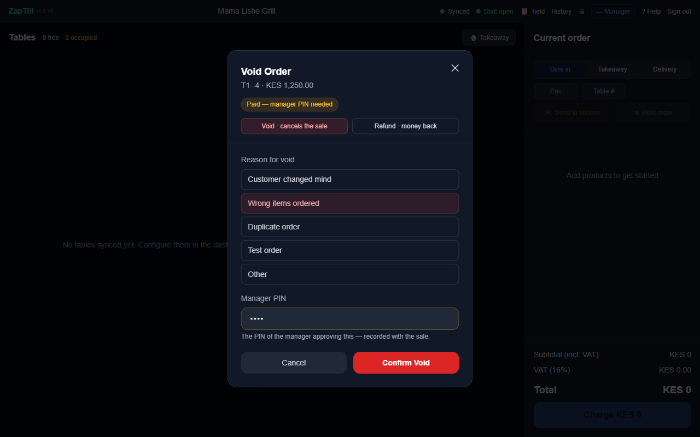

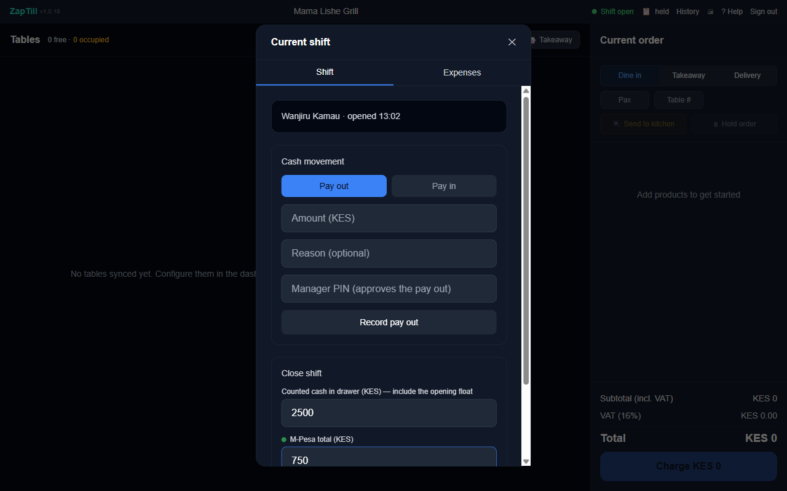

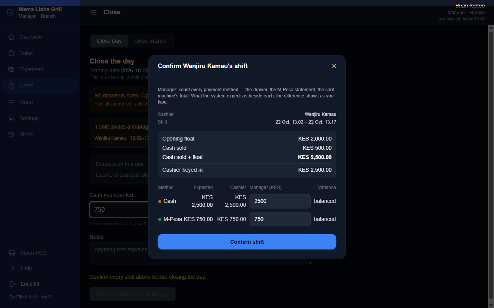

**Things that catch people out**

- **A manager's PIN is refused for a sale on account** on a till with no branch server: that manager must have signed in on this till at least once. Have each manager sign in once during setup.
- **The till locks itself** after Windows has been idle for a while ("Till locked"). Nothing is lost; enter the PIN to continue.
- **No Void button for cashiers.** That is by design: voids need a supervisor or manager.
- **Close Day refuses** until every shift above it is confirmed.

| Message | Meaning |
| --- | --- |
| That PIN was not recognised | Wrong PIN, or the person has no access at this branch |
| Too many wrong PINs on this till | Wait for the lockout to end |
| Payments must add up to KES {n} | The split legs don't add up to the total |
| {name} has no credit limit / Over {name}'s credit limit | The owner or a manager sets or raises the limit (Credit Accounts) |
| This order is {n} minutes old, past the void window | Use Refund instead |
| Confirm every shift above before closing the day | Confirm each shift first |

## Step 11 — Technician access

The Tech page on each till is how a technician fixes things later: sync, rejoining, printers, updates, logs and backups. It opens with a branch reveal code plus a 48-hour token from the admin portal, with no internet needed on site.

**11a. Get a token (admin portal).** Sidebar › **Tech access › Generate Tech Access Token**. Pick the **Client** and **Branch**, click **Generate Token**. You see, once only:

- the **Reveal code** (entered first on the till), with **Copy** and **Rotate**;
- the **token** (`st2.…`), valid for that branch for 48 hours, with **Copy token**.

A second super admin confirms each token. Click **Rotate** to end a technician's access: the old reveal code stops at once, and tills fetch the new one at their next sync.

**11b. Open the Tech page on the till.**

1. On the PIN screen, **press and hold the logo or business name** for about a second.
2. **Technician access**: type the reveal code into **ACCESS CODE**, click **Continue**.
3. **Technician token**: paste the token, click **Unlock**.

**11c. What the Tech page does.** A session lasts about 4 hours (**End session** to finish), and every action is recorded against you.

| Section | Use it to |
| --- | --- |
| Device | See the device ID, name, role, branch, server and build |
| Sync | See waiting and failed records; **Force sync**, **Retry failed** |
| Rejoin this till | Rejoin with a Business ID and a new enrolment code; nothing is cleared |
| Diagnostics | **Scan printers**, **Test connection**, **View log**, **Send logs to support** |
| Branch role | **Promote to branch server**, **Find my server** |
| Updates | Check the version and that **Updater task: installed** |
| Backups & retention | **Back up now**; choose a USB drive or second disk for backups |
| Reset this device | **Check what this would delete** before any reset |

**11d. Logs, two ways.**

- **From the till:** **Tech › Send logs to support** sends the last 24 hours (secrets removed) and shows a reference, e.g. "Sent — reference DZG52F". The client can read it to you over the phone. Up to 5 an hour; if the till is offline, **Save log to file** instead.
- **From the admin portal, with nobody at the shop:** client › **Desktop updates › Pull logs**. Choose the till, the period (24 hours, 3 days, 7 days), optionally **Include sign-in history**, give a reason, **Request**. The row turns **Delivered** with **View** and **Download**. Find any log by its reference under **Support logs**.

**11e. Updates.** Client › **Desktop updates**: **Choose a version… › Approve** (super admin). **TILLS NOW** shows each till's state: Up to date, Downloading, Downloaded, or "can't install silently on this PC (no ZapTill Updater task)" — run the installer once as administrator on that PC to fix it.

**Remote help without a visit:** pull logs; close a day or a drawer remotely from **Tills & days** (with a reason; the owner is emailed); reset the owner's password or sign-in code from **Owner & account**. There is no remote-desktop feature.

## Handover checklist

Tick every line before you leave the site.

- [ ] **Admin portal:** every branch desktop-licensed (the first licence before web access, so the cloud trial starts); the Cloud plan set (period and amount) and the first payment recorded, or the trial's end date told to the owner; Analytics, receipt options and the approval PIN switch as sold; a desktop version approved
- [ ] **Owner:** signed in on the dashboard and chose a private password on **Set your password** (you did not see it); sign-in codes on or off as agreed; **When an item's stock reaches zero** chosen; told when the cloud trial ends, if on one
- [ ] **Business profile:** address, KRA PIN, receipt header and footer; **Business day ends at** matches the closing time
- [ ] **Menu:** uploaded, with costs or recipes, variants and extras checked, menus making sense on the till
- [ ] **Staff:** everyone has their own PIN (no two the same); each manager has signed in once on each till; web access given to partners and accountants
- [ ] **Payments:** the methods the shop takes are on; the M-Pesa number is set on each branch's till; credit customers have limits (**+ Give credit**), set by the owner or a manager, not by you; if the owner wants it, **Credit approvals** chosen per branch
- [ ] **Every till:** right branch, unique terminal code, device name; **Updater task: installed** on Tech › Updates
- [ ] **Printers:** **Print through these printers** ON; every station has a printer (or another till handles it); paper width matches the roll; test print OK; the drawer opens on a cash sale
- [ ] **Branch server** (if any): keep-running settings done; every till joined and "Encrypted"; Close Branch visible on it
- [ ] **Test run** done (Step 10), then the test sales cleared: admin › **Owner & account › Clear test data…** — set the testing start and stop times, choose "Put back as before testing" for stock, **Show what will be removed**, type the client's name, **Clear test data** (super admin; the menu stays)
- [ ] **Daily Report Email:** on, with recipients and a send time
- [ ] **Hand the owner:** the dashboard address, the support number, and the reveal-code note for the branch server

## Common problems

| What you see | Fix |
| --- | --- |
| This branch has no desktop licence (till PIN screen) | Admin › Branches & tills › **Activate licence** |
| Invalid, expired or already-used code | Mint a new code with **Enrol till** (15-minute expiry, single use) |
| That code is for a different branch | Use a code from the till's own branch |
| This till is no longer joined to the business | Tech › **Rejoin this till** with a new code |
| This device is not yet approved (web POS) | Dashboard › Devices › **Approve**; tills never need this |
| OFF — nothing will print | Tick **Print through these printers** |
| Looks like the printer is off or unreachable | Check power, cable and IP; print the printer's self-test page to read its IP |
| Receipt's right-hand column wraps | Set **Paper width** to the roll in use |
| No branch server answered on this network | Server on and ZapTill running; both PCs on the same network, profile **Private** |
| Could not reach that branch server | Check the firewall rules (TCP 4100–4103, UDP 4199) and the Private profile |
| Port 4100 in use (only in the server log) | Close the program holding 4100; tills that know the server follow it |
| That PIN was not recognised (sale on account) | The manager signs in once on this till, or use a branch server |
| Web portal access is not enabled for your account | Admin › Plan & billing › Cloud plan › **Record payment** |
| Your web portal subscription has expired | Renew: set a new web access expiry |
| Sign-in code not arriving | Check spam, wait 45 seconds, **Send a new code**; admin › **Reset to email code** |
| Trading day {date} was never closed on this till | A manager closes it (Manager › Close › Close Day), or close it remotely in Tills & days |
| This till's clock is {n} min ahead of/behind the server | Fix Windows time and time zone (Nairobi); turn on automatic time |
| Late-night sales land on the wrong day | Profile › **Business day ends at** (e.g. 02:00) |
| This is part of the online licence | Admin › Plan & billing › **Record payment** (or **Convert to paid** after a trial) |
| Your cloud trial has ended | Admin › Plan & billing › **Convert to paid**; tills are not affected |
| Installer downloads are not set up on this server | A developer sets `DESKTOP_DOWNLOAD_BASE_URL` or `GITHUB_RELEASES_TOKEN` on the cloud (Step 7a) |
| The owner's role belongs to the owner alone | Give the person another role, e.g. General Manager |
| {Item} is sold out. / Only {n} of {item} left. | The zero-stock setting is on (Step 3) and the branch's stock is at zero: receive stock, or ask the owner to choose **Sell as normal** |
| Someone sees "Only the owner or a manager sets credit limits." | By design: only the owner and the built-in Manager role set credit limits (Step 6) |
| "A sale on account needs the approval of someone the owner chose" | Credit approvals is on: enter the PIN of someone ticked for this branch, or the owner's (Step 6) |
| A shop's screens say Menus, tables or kitchen | Wrong business type: Admin › client › **Edit details** › type (Step 1) |
| Pull logs stays Waiting | Use Tech › **Send logs to support** and ask for the reference |

**Settled in 1.0.20** (the open questions of version 1.0 of this guide):

- **Where to get the installer:** the admin portal's **Download ZapTill** (Step 7a). The till's server address is not pre-filled; type `https://api.zaptill.co.ke` (Step 7d).
- **A first credit limit for a customer:** **+ Give credit**, the customer's profile, or **+ New Customer** (Step 6).
- **The owner's forced password change:** now enforced at the first sign-in and after an admin password reset (Step 3).
- **What the cloud costs and what happens when a client stops paying:** a payment plan per business, month on month by default (KES 3,000 a month, editable), recorded with **Record payment**; an invoice is emailed on the first day of each period; unpaid 7 days after it the dashboard is paused and the tills keep selling but stop syncing, and no till can be joined until it is paid; reminders go to ZapTill only (Step 2b).
- **Plan: None for a new client:** there is no trial plan; the first desktop licence starts a one-month cloud trial, and **Plan** reads No licence yet, Desktop, Cloud trial, Cloud trial ended or Cloud (Step 2).

- **Who approved a credit limit, and each credit sale:** the customer's **Credit history** (Step 6).

*Screenshots show the real ZapTill apps running a made-up demo business (Mama Lishe Grill). The branch-server Allow prompts are mock-ups. The 1.0.20 screens (02g, 02h, 02i, 03i, 03j, 03k, 06g, 06h, 06i, 06j, 06k, 07a2) are the real admin portal and dashboard screens fed made-up demo data, without a live backend; the business ID, dates and checksum in them are made up.*
